<h1 align="center">Publr</h1>

<p align="center">
  <b>Build and run enterprise-grade websites and web apps. With AI, by hand, or in code.</b><br>
  A full platform in one small binary: content, users, plugins and a real admin for all of it.<br>
  Every plugin sandboxed. Fast, accessible, SEO-ready pages by default. Runs anywhere.
</p>

<p align="center">
  
  
  
  
</p>

<p align="center">
  <a href="https://publr.dev"><b>publr.dev</b></a> ·
  <a href="docs/">Docs</a> ·
  <a href="https://github.com/publr-org/publr/releases">Releases</a>
</p>

<br>

<p align="center">
  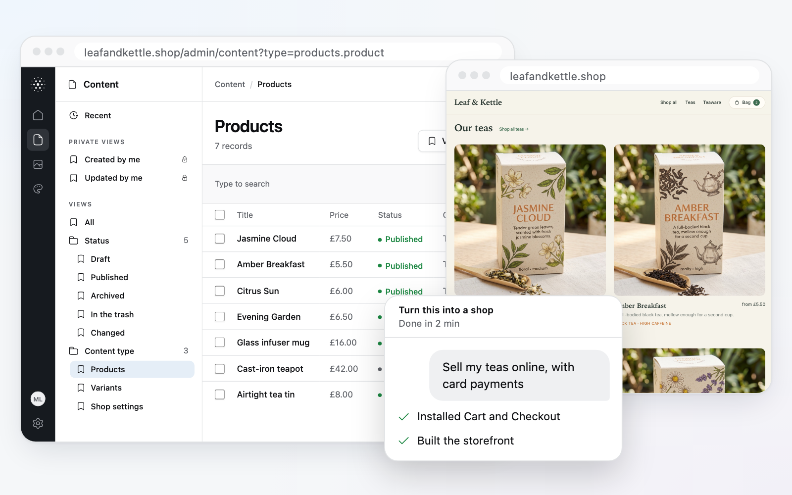
</p>

<p align="center">
  <a href="#work-the-way-the-task-wants">Agents, admin, code</a> ·
  <a href="#just-build-the-output-takes-care-of-itself">Output</a> ·
  <a href="#a-real-home-for-your-data">Admin</a> ·
  <a href="#why-it-works-one-contract">One contract</a> ·
  <a href="#sandboxed-plugins">Sandboxed plugins</a> ·
  <a href="#under-the-hood-plain-code">Code</a> ·
  <a href="#runs-anywhere-exactly-the-same">Runs anywhere</a>
</p>

<br>

<table>
  <tr>
    <td width="50%" valign="top">
      <h3>🤖 Agent-ready</h3>
      Bring any agent you like. It can build apps and plugins, model the schema and
      manage content: anything you can do, under your permissions.<br><br>
    </td>
    <td width="50%" valign="top">
      <h3>⚡ Quality by default</h3>
      Static pages with islands, optimized images, accessible and made for search.
      Nothing to configure. Just build.<br><br>
    </td>
  </tr>
  <tr>
    <td width="50%" valign="top">
      <h3>🗂️ A real admin</h3>
      Your data gets a proper home: content, structure, media, people and roles, made
      for the people who run the site every day.<br><br>
    </td>
    <td width="50%" valign="top">
      <h3>🛡️ Sandboxed plugins</h3>
      Every installed plugin runs sealed off, with only the access you grant. Inside one
      small binary: no extra server, no vendor cloud.<br><br>
    </td>
  </tr>
</table>

<br>

## Work the way the task wants

Some changes are faster to ask for. Some are faster to click. Some you want to write
and review yourself. Publr never decides for you: every part of it is open to every
way of working.

| | Ask your agent | Use the admin | Write code | CLI and API |
|---|:---:|:---:|:---:|:---:|
| Define content types and fields | ✓ | ✓ | ✓ | ✓ |
| Write, edit and translate content | ✓ | ✓ | ✓ | ✓ |
| Publish, review, roll back | ✓ | ✓ | ✓ | ✓ |
| Add a shop, bookings, a newsletter | ✓ | ✓ | ✓ | ✓ |
| Manage people and roles | ✓ | ✓ | ✓ | ✓ |

"Your agent" means whichever one you already use: Claude Code, Codex, Cursor or any
other that runs commands. One skill teaches it Publr, and from there it builds apps and
plugins, models the schema and manages content, with exactly the permissions you give
it. [Agents](docs/agents.md)

Build the whole site with a prompt and fix one typo by hand. Design the schema
yourself and let the agent fill in a hundred products. Script a change, then check it
in the admin. All of it lands in the same place, under the same rules.

## Just build. The output takes care of itself.

Whoever builds it, the agent or you, what comes out is fast, accessible and ready for
search engines. Nothing to configure, no checklist to work through.

<table>
  <tr>
    <td width="45%" valign="middle">
      <h3>Static first</h3>
      Every page is built to a plain HTML file and served as a file: instant to load,
      cheap to host, cacheable anywhere. The stylesheet is inline, holding only the
      classes the page uses.
    </td>
    <td width="55%" valign="middle">
      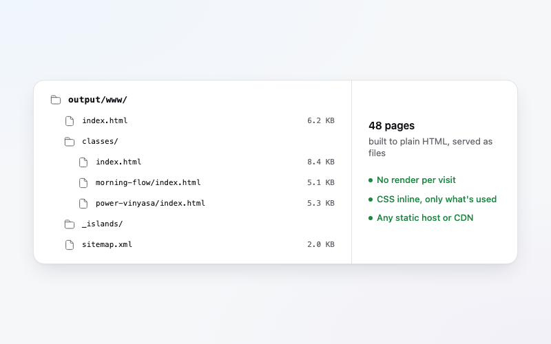
    </td>
  </tr>
  <tr>
    <td width="45%" valign="middle">
      <h3>Islands where it matters</h3>
      What must be fresher than a file, or interactive, is an island: built once and
      shared, or rendered for each visitor. A component's script loads only where an
      island needs it.
    </td>
    <td width="55%" valign="middle">
      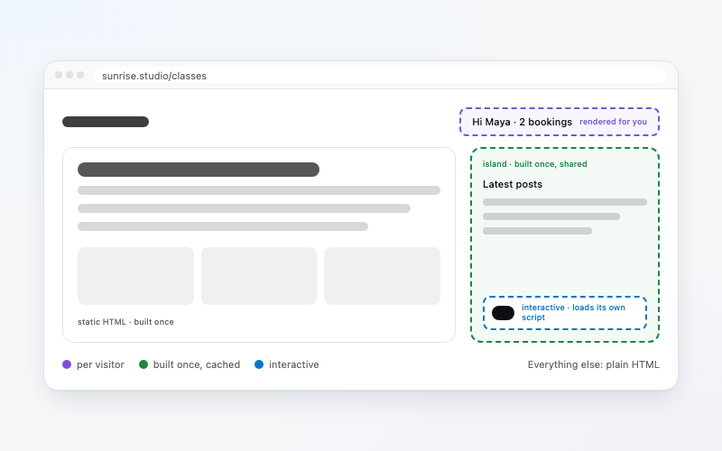
    </td>
  </tr>
  <tr>
    <td width="45%" valign="middle">
      <h3>Instant updates</h3>
      When a record changes, only the pages that read it are rewritten. Live at once:
      no build queue, no cache to purge.
    </td>
    <td width="55%" valign="middle">
      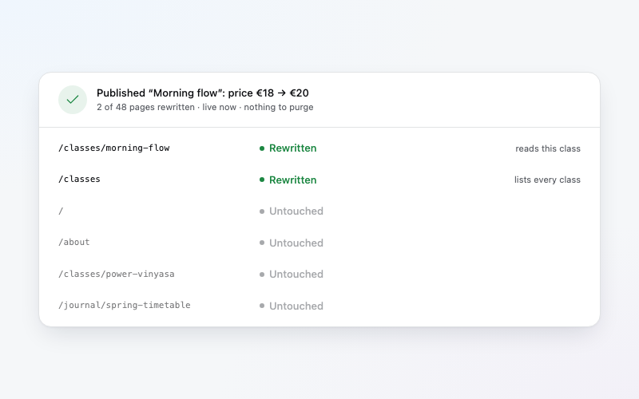
    </td>
  </tr>
  <tr>
    <td width="45%" valign="middle">
      <h3>Accessible and responsive</h3>
      Semantic markup on components made to meet WCAG, usable by keyboard and screen
      reader, fitting every screen from a phone to a wide monitor.
    </td>
    <td width="55%" valign="middle">
      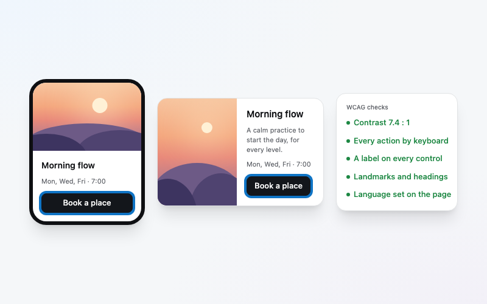
    </td>
  </tr>
  <tr>
    <td width="45%" valign="middle">
      <h3>Optimized images</h3>
      Each image is resized on the server to the size the page asks for, as WebP,
      cropped around its focal point. Upload once, never export a thumbnail again.
    </td>
    <td width="55%" valign="middle">
      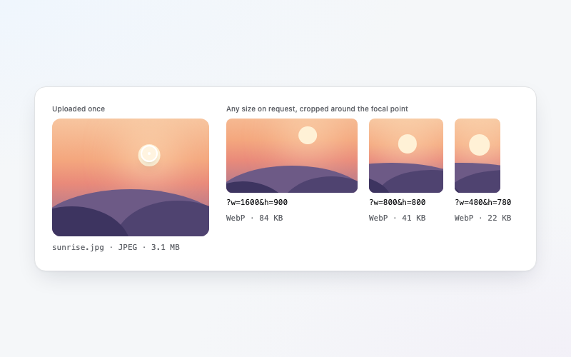
    </td>
  </tr>
  <tr>
    <td width="45%" valign="middle">
      <h3>Made for search</h3>
      Real HTML on every URL and a sitemap per app. With languages, each language's
      pages live at their own address, linked with <code>hreflang</code>.
    </td>
    <td width="55%" valign="middle">
      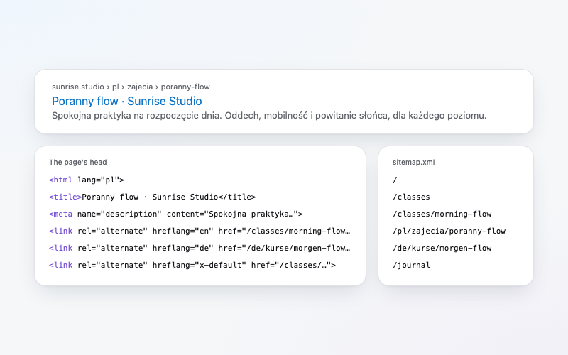
    </td>
  </tr>
</table>

## A real home for your data

Your content is not rows in a database you inspect with a separate tool. Publr ships
an admin built for the people who live with the site every day.

<table>
  <tr>
    <td width="45%" valign="middle">
      <h3>Content in forms or visually</h3>
      One control per field, or a block editor for pages written like documents. Lists
      you can filter, sort and act on in bulk.
    </td>
    <td width="55%" valign="middle">
      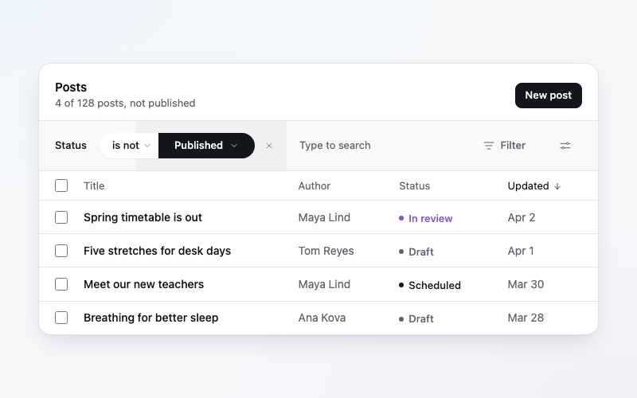
    </td>
  </tr>
  <tr>
    <td width="45%" valign="middle">
      <h3>Structure you can see</h3>
      Content types, fields, taxonomies and their rules, made and changed from the
      admin. Every write is checked against them, whoever makes it.
    </td>
    <td width="55%" valign="middle">
      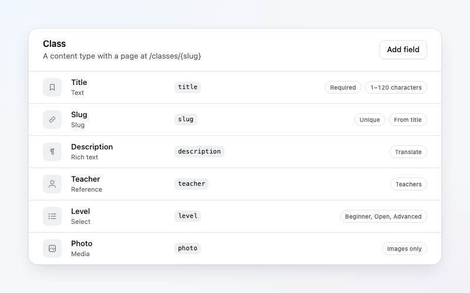
    </td>
  </tr>
  <tr>
    <td width="45%" valign="middle">
      <h3>Publishing with a process</h3>
      Drafts, statuses, and who may move a record from one to the next. Work on a
      branch, review every change, merge it as one deployment, roll back at once.
    </td>
    <td width="55%" valign="middle">
      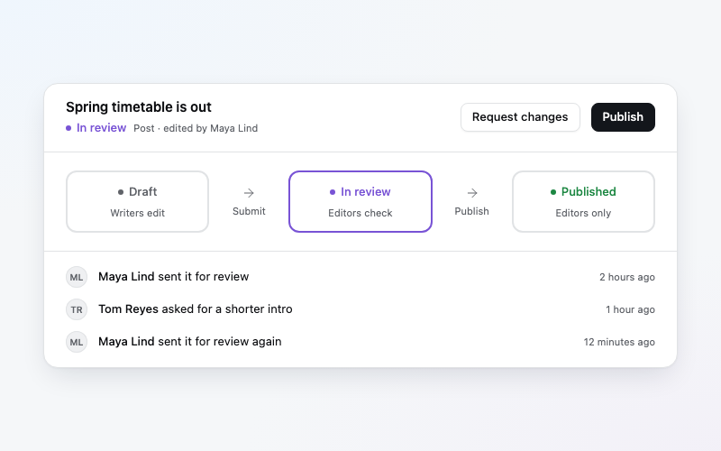
    </td>
  </tr>
  <tr>
    <td width="45%" valign="middle">
      <h3>Media library</h3>
      Folders, tags, alt text and focal points, with every size the site needs made on
      the server.
    </td>
    <td width="55%" valign="middle">
      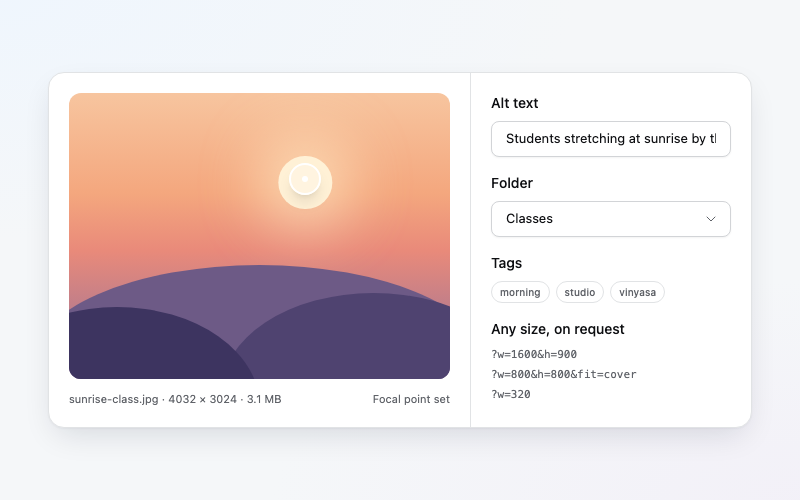
    </td>
  </tr>
  <tr>
    <td width="45%" valign="middle">
      <h3>People and roles</h3>
      Roles that say exactly what each person may see and change, shown as a table of
      the admin's parts. Plugins bring roles of their own.
    </td>
    <td width="55%" valign="middle">
      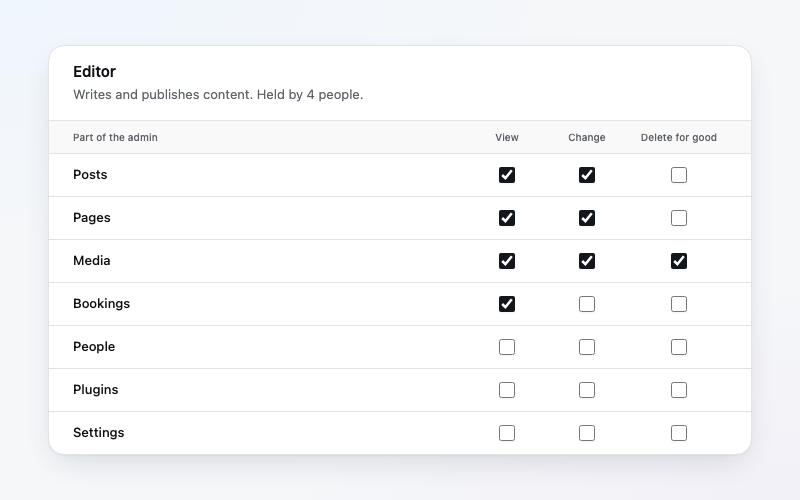
    </td>
  </tr>
  <tr>
    <td width="45%" valign="middle">
      <h3>Every language</h3>
      Mark a field Translate and it holds a value per language. Switch languages in the
      editor; the site serves each one at its own address.
    </td>
    <td width="55%" valign="middle">
      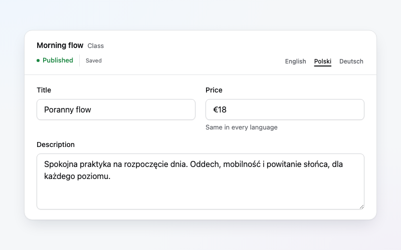
    </td>
  </tr>
  <tr>
    <td width="45%" valign="middle">
      <h3>An agent beside you, if you want one</h3>
      Ask from any page and watch it work, step by step, with Undo. Or don't: the
      admin is complete without it.
    </td>
    <td width="55%" valign="middle">
      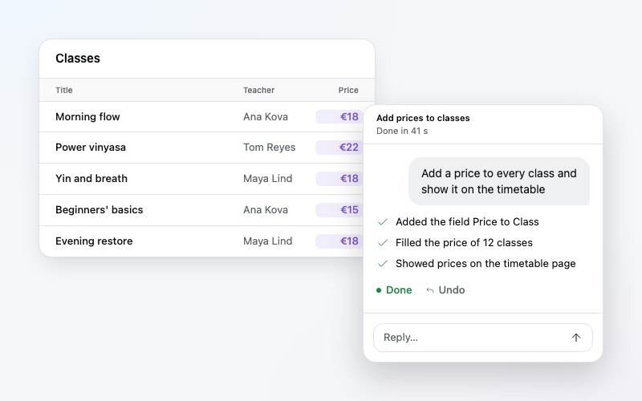
    </td>
  </tr>
</table>

## Why it works: one contract

Every capability in Publr, from creating a record to signing in, is one **operation**.
The admin, the CLI, the REST API, plugins and agents are all thin doors onto the same
operations, through one pipeline that checks permissions, validates input, runs in a
transaction and records what happened.

So nothing is AI-only and nothing is UI-only. A feature added once is there for every
door, documented. An agent can do exactly what its person may do, no more, and there is
no back door for anyone. [Architecture](docs/architecture.md)

## Sandboxed plugins

Every installed plugin runs in its own WebAssembly sandbox, inside the Publr binary.

<table>
  <tr>
    <td width="45%" valign="middle">
      <h3>Permissions you approve</h3>
      Each plugin lists what it needs and why. You switch each one on or off. An update
      that asks for more waits for you.
    </td>
    <td width="55%" valign="middle">
      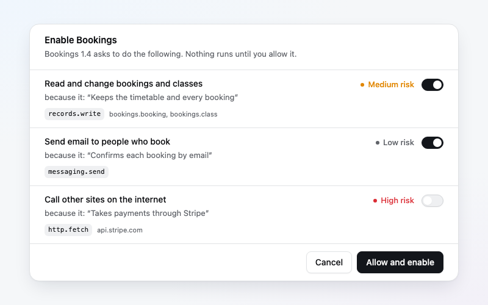
    </td>
  </tr>
  <tr>
    <td width="45%" valign="middle">
      <h3>Sealed off</h3>
      No access to the database, files or other plugins. One way out: the same checked
      operations as everyone else. Acting for an editor, never more than that editor.
    </td>
    <td width="55%" valign="middle">
      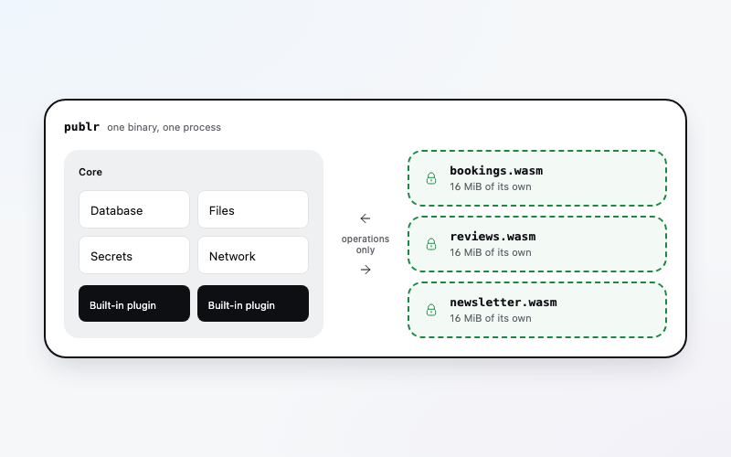
    </td>
  </tr>
  <tr>
    <td width="45%" valign="middle">
      <h3>Failures stay contained</h3>
      Every call has limits on time and memory. A plugin that crashes or loops stops
      alone. The site keeps running.
    </td>
    <td width="55%" valign="middle">
      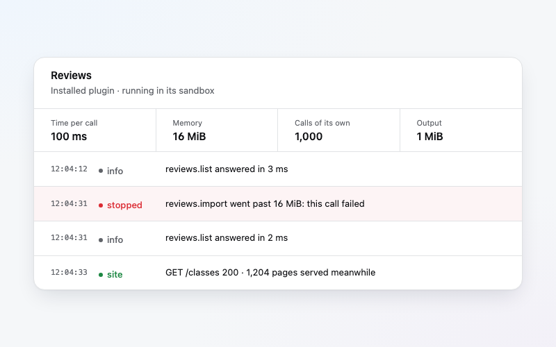
    </td>
  </tr>
  <tr>
    <td width="45%" valign="middle">
      <h3>Secrets it never sees</h3>
      Publr adds the API key as the request leaves. Calls go only to the domains you
      approved.
    </td>
    <td width="55%" valign="middle">
      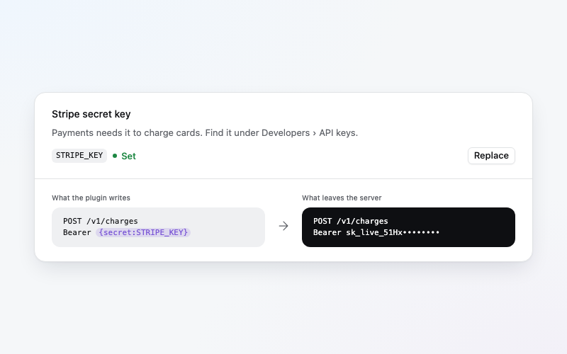
    </td>
  </tr>
  <tr>
    <td width="45%" valign="middle">
      <h3>Extends everything</h3>
      Content types, operations, roles, jobs, webhooks, admin pages, columns, field
      editors, site pages. Everything it draws is sanitized or framed.
    </td>
    <td width="55%" valign="middle">
      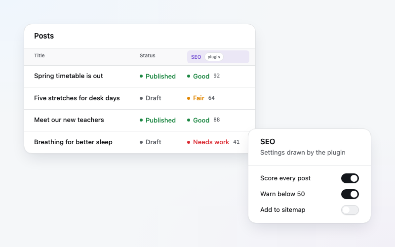
    </td>
  </tr>
  <tr>
    <td width="45%" valign="middle">
      <h3>No rebuild, no extra server</h3>
      Install, update, roll back and remove from the admin. No VM, no container, no
      vendor cloud.
    </td>
    <td width="55%" valign="middle">
      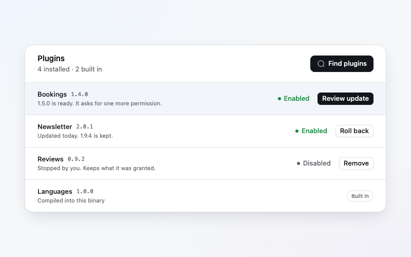
    </td>
  </tr>
</table>

| | No sandbox | Developer's server | Platform VMs | Wasm functions | **Publr** |
|---|:---:|:---:|:---:|:---:|:---:|
| Every plugin sandboxed | ✗ | ✓ | ✓ | ✓ | **✓** |
| Failures contained | ✗ | ✓ | ✓ | ✓ | **✓** |
| Open source, self-hosted | ✓ | ✗ | ✗ | ✗ | **✓** |
| No vendor lock-in | ✓ | ✗ | ✗ | ✗ | **✓** |
| No extra server or VM | ✓ | ✗ | ✗ | ✓ | **✓** |
| Extends everything, UI included | ✓ | partly | partly | ✗ | **✓** |

## Under the hood, plain code

What an agent writes is what you would write: readable code you can review and own.

<details>
<summary><b>A content type</b>: a Zig struct, its fields and rules</summary>

```zig
/// Post
///
/// An article on the blog, with a page of its own.
pub const Post = struct {
    /// Title
    title: []const u8,
    /// Slug
    slug: ?[]const u8 = null,
};

pub const Posts = publr.record.define(Post, .{
    .name = "blog.post",
    .public = true,
    .fields = .{
        .title = .{ .validation = .{ .min_len = 1, .max_len = 120 } },
        .slug = .{ .kind = "slug", .options = .{ .source = "title" } },
    },
});

pub const plugin = publr.plugin.define(manifest, .{ .records = &.{Posts} });
```

The doc comments become the labels and help in the admin. The same type can be made in
the admin, no code needed. [Plugin API](docs/plugin-api.md)

</details>

<details>
<summary><b>A page</b>: a <code>.publr</code> template, built to a static file</summary>

```astro
---
import Base from '../../layouts/base.publr';
import LatestPosts from '../../components/latest-posts.publr';
const post = Publr.build.getEntry();
---
<Base title={post.title}>
  <article>
    <h1>{post.title}</h1>
    <LatestPosts heading="More posts" island />
  </article>
</Base>
```

`content/posts/[slug].publr` is one page per published post. Publish a post and only
the pages that read it are rewritten. [Apps](docs/apps.md)

</details>

<details>
<summary><b>A query</b>: GROQ, nested records in one read</summary>

```groq
*[_type == "product" && slug == $slug][0]{
  title,
  "variants": *[_type == "variant" && product == ^._id] | order(price.GBP) { title, price }
}
```

The same query runs in templates, from the CLI and at `GET /api/record.query`.
[Queries](docs/queries.md)

</details>

## Enterprise grade, small core

- **Many apps, one project.** A marketing site, a members area, a product people pay
  for, its docs: each an app over the same content and plugins. Fix it once, every app
  gets it.
- **Built-in back office.** Database, sign-in, users, roles, media, queued jobs,
  schedules and webhooks. Nothing to wire up, no separate bills. [SDK](docs/sdk.md)
- **Permissions decided once.** Every call, from a person, a plugin, a token or an
  agent, is judged by the same policies. When in doubt, Publr does not allow.
  [Auth](docs/auth.md)
- **Updates you can trust.** Every update backs the whole site up first, and a failed
  one rolls back and says why. [Updates](docs/updates.md)

## Runs anywhere, exactly the same

| Where | How |
|---|---|
| **Your computer** | One process, one port, one file of data. |
| **Your server** | Copy the binary and the site's folder. A $5 VPS is plenty. |
| **Publr Cloud** | Hosted, with changes made on a branch before they reach the live site. |
| **A browser tab** | The same binary as WebAssembly, behind a service worker. No server. |
| **Any static host** | Every app built to plain files. |

Leave whenever you like. Your site is a folder: take it with you.

## We own every layer

Publr is Zig from the HTTP server to the templates, the CSS engine and the admin.
No npm, no bundler, no framework, no build-time network access. Three libraries
(SQLite, stb, libwebp), vendored as-is. When something is slow, wrong or insecure, the
fix is in this repository, not on someone else's roadmap.

The core stays small enough to read in an afternoon. Workflows, environments,
languages and integrations are plugins on the same SDK any third party uses, so the
plugin API stays honest: Publr is its heaviest user.
[Philosophy](docs/philosophy.md) · [Dependencies](docs/dependencies.md)

## Status

**v0.2, early access.** Publr is moving fast, and formats may still change between
releases. [Updates](docs/updates.md)

## Learn more

| Running a site | Building on it | How it works |
|---|---|---|
| [Content](docs/content.md) | [Agents](docs/agents.md) | [Philosophy](docs/philosophy.md) |
| [Admin](docs/admin.md) | [Apps](docs/apps.md) | [Architecture](docs/architecture.md) |
| [Authentication](docs/auth.md) | [Plugins](docs/plugins.md) | [SDK](docs/sdk.md) |
| [Queries](docs/queries.md) | [Plugin API](docs/plugin-api.md) | [Database schema](docs/schema.md) |
| [CLI](docs/cli.md) | [REST API](docs/rest.md) | [Publr in the browser](docs/browser.md) |
| [Updates](docs/updates.md) | [Streaming islands](docs/streaming.md) | [Build reference](docs/build.md) |

## License

[Apache 2.0](LICENSE).
