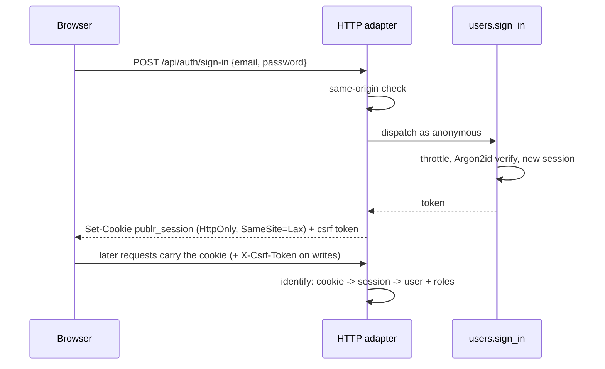
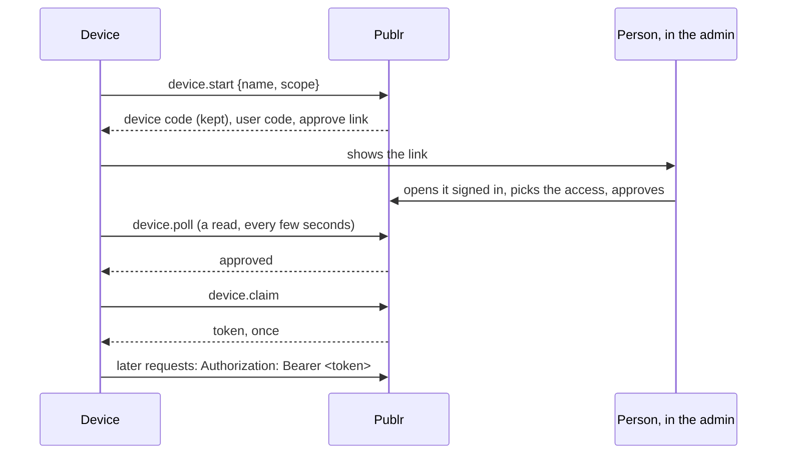
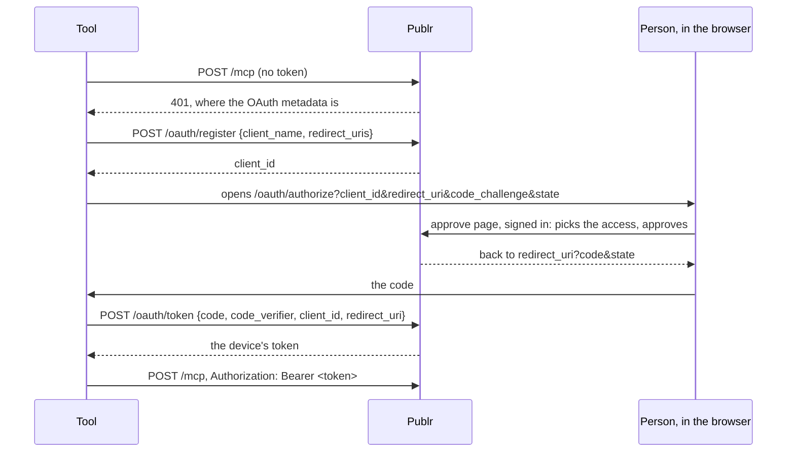

# Authentication

How people get in, and how Publr keeps everyone else out. The mechanics live in
operations (`project.init`, `users.sign_in`, `users.sign_out`,
`users.set_password`, ...) so the CLI, the HTTP routes and plugins all go
through the same doors; see [CLI: users](cli/user.md) and [REST API](rest.md)
for the surfaces.

## Signing in

Passwords are hashed with Argon2id and never stored. A session is a random
`id.secret` token; only a hash of the secret is stored, so a leaked database
does not leak sessions. Sessions slide (they extend on use) and expire after
thirty days of silence; signing out revokes them.

New accounts can be created with a password, with a generated one shown
once, or with no password at all: then the account is inactive until the
person redeems a one-hour, single-use set-password link (which an admin can
reissue at any time): the admin's welcome screen, `/admin/welcome?token=…`, where they
also choose their language, and from which they are signed in. Setting a password signs out every session of that
account.

Wrong passwords cost the same time as right ones and give the same answer for
unknown accounts, so nothing about who exists leaks. After a handful of
failures an account waits before it may try again, for longer each time (one
minute, then five, fifteen, sixty), and never permanently. The wait is counted for
the account and the address the failures came from together, so a stranger guessing
from elsewhere cannot lock a real user out. Every attempt is announced as an event
(`auth.sign_in_succeeded`; `auth.sign_in_failed`, `auth.sign_in_throttled`,
`auth.sign_in_locked`, kept though the refused sign-in's write rolls back and heard
by `on` hooks) that plugins can act on: alerts, CAPTCHA, IP rules, second factors, all
belong in plugins, not the core.

Browser requests that change something must come from the same origin and
carry a per-session CSRF token; requests without a browser cookie (the CLI,
a device's token) are unaffected.

A project has one set of accounts and one session for the admin and every app. When an
app answers on a subdomain ([Apps](apps.md#where-an-app-answers)), the session cookie is
set for the project's whole domain, so one sign-in holds everywhere. Two separate sets
of accounts are two projects.

With `serve --admin-url`, the admin signs in on its own host and the session cookie stays
there: host-only, never set for a domain, so the site's host never receives it. Where it
does arrive (the admin and the site on two ports of one name share cookies), the site's host
treats it as nobody's for everything of core's: the API, uploads and the session answer. An
app's own pages still see the person signed in. The admin's pages, and the pages where a
tool is approved (`/oauth/`), are framed only by a page of their own origin.

## Signing in with a provider

A provider plugin (GitHub, Google, one folder each, compiled in) proves who someone is
and hands the core an identity: the provider's name, its stable id for the person, and
the email it reports, with whether it vouches for that email. The core keeps which
account each identity belongs to and never the provider's tokens: Publr signs people in,
it does not act on GitHub for them.

A button sends the browser to `/auth/<provider>`, which makes a `state` and a PKCE pair,
keeps them in a ten-minute cookie and redirects to the provider; the provider sends the
browser back to `/auth/<provider>/callback`, which checks the state and runs the plugin's
exchange: the one step of a sign-in that waits on another server. It sends requests only to
the plugin's own `http.fetch` domains (its client secret, a declared secret, filled in as
they leave), for at most 10 seconds, and answers who the code stands for; it never makes a
session or picks the account. No answer in time, or an error, and the login says "That
sign-in didn't go through. Try again."; the plugin's log says why (`sign_in:<provider>`).
A provider is offered when its client id is in the environment and its declared secrets are
set. Every offered provider is listed by `identity.providers`, which
the admin's login page uses and an app's may. The callback is the request's own origin;
`PUBLR_AUTH_CALLBACK_ORIGIN` advertises another (a public host that sends the browser on to
a machine the providers cannot reach, during development).

`identity.sign_in`, called as the system by the provider's callback (an administrator may
call it too, and could sign in as anyone anyway), decides whose identity it is, in this
order:

1. The account it is linked to, by provider and id. Email is never the key: emails
   change and providers reuse them.
2. Otherwise, the active account with that email, which is linked on the way, but only
   when the provider vouches for the email. An unverified email links nothing.
3. Otherwise, nobody: `wrong email or password`, the same answer as a wrong password.
4. Unless an administrator opened sign-up (`identity configure --open_sign_up <role>`):
   then a new account with that role, still only from a verified email. The role is a
   member role, never one that reaches the admin. Sign-up is closed by default.

An account made this way has no password and may add one later; an account with a
password may link identities (`identity link`, by the system for a signed-in person) and
list or drop its own (`identity list`, `identity unlink`, which `editor` grants; an
administrator names any account). Someone signed in who goes through a provider button
links that identity to their account instead of starting a session. The last identity of an account
without a password cannot be dropped: that would lock the account out. Signing in through
a provider opens an ordinary session, with the same cookie, CSRF token, expiry and
sign-out; and it raises events like password sign-in (`auth.identity_signed_in`,
`auth.identity_linked`, `auth.identity_refused`, `auth.identity_unlinked`).

### Behind an identity-aware proxy

A proxy in front of the admin (Google IAP, with the `auth_iap` plugin) decides who may
reach it and signs who someone is into a header on every request. Its provider plugin reads
that header instead of redirecting. While the provider is available:

- The admin's login page sends people straight to `/auth/<provider>`, which reads the header
  and signs them in by the rules above: the linked account, else the account with that
  email, which is linked on the way, whether or not it has a password yet. So an account an
  administrator made is claimed on the person's first visit. Nobody else gets in, and the
  login page says so without saying why.
- A session counts, on the admin's host, only while the request's header names an identity
  linked to the session's account. A request without the header, with one that does not
  check out, or with someone else's is nobody's, so someone the proxy no longer lets through
  is out on their next request.
- Device tokens are Publr's own and are not checked against the header.
- On the admin's host there is no password sign-in: the login page has no form, a password
  posted to `/admin/login` goes back to the proxy's way in, and `/api/auth/sign-in` answers
  `403 sign_in_through_proxy`. The first-time setup and the site's own visitor sign-in stay.
- Someone the proxy lets through with no account gets what the provider says
  (`from_request.new_member`): nothing, which is the default (an administrator adds each
  person); an account with no role, which waits for an administrator ("Waiting for
  access"); or an account with roles an administrator chose, staff roles included. The
  account is made only from an email the provider vouches for, and only the system passes
  those roles to `identity.sign_in` (`new_account_roles`); an account that exists keeps its
  own. This is the one way an account is made with a staff role other than by someone who
  manages users: staff made the rule in advance, and the proxy vouches for the person.
- Logging out ends the Publr session only, never the person's account at the proxy. The
  login page then says they are signed out instead of signing them straight back in;
  opening the admin again signs them in.

Accounts, roles and devices stay in this database. Removing someone at the proxy does not
revoke their devices: an administrator does that under Settings › Devices.

## Devices

A device is an agent or a tool that a person lets act for their account: the CLI on
another machine, an agent in a terminal, a chat app. It signs in by link, never with a
password or a pasted token.

`publr login <address>` does all of this. The token is `id.secret`; only the hash of the
secret is stored. A device never expires: its person, or an administrator, revokes it
under **Settings › Devices**, and it stops working at once.

A device acts as its account, with that account's roles, narrowed by the **scope** its
person approved:

| Scope | What the device may do |
|---|---|
| `read` | read what its account may read |
| `write` | write as its account may on the site's copies (environments and branches), publishing there included: nothing there is live until a person merges it. On production every write is refused with `WorksOnCopies`, making a copy excepted. On a Publr that keeps no copies, it writes to the site but nothing visitors see changes, as `production` |
| `production` | also write on production, but nothing visitors see changes: a write that publishes or unpublishes something (a `*.published` or `*.unpublished` event) is refused whole with `DraftsOnly`, so edits wait as drafts for a person |
| `publish` | everything its account may |

The admin offers them as Read only or Read and write, then Write on production (a Publr that
keeps copies only) and Publish, each only under the one before; Read and write is chosen to
begin with. **Settings › Devices** has Edit access beside Revoke (`device update`): an
account changes its own devices, an administrator anyone's, never a device itself, and it
counts from the device's next call.

Whatever its scope, a device never destroys data for good. An operation that declares
`destroys` (purging a record or a term; pruning snapshots; removing something from the
trash, or emptying it) is not run for it: it goes on the device's removal list for its person, and the call fails
with `ListedForRemoval`, saying where the list is ([`removal`](cli/removal.md)). The person
reviews the list and removes what they agree to, as themselves. A removal that can be
undone stays the device's to do: moving records and terms to the trash, and deleting a
content type, a taxonomy, a field group, a plugin, media, an app's file, a user or a secret,
which keep a copy in the trash ([`trash`](cli/trash.md)). A device never approves another
device, and a request carrying its token needs no CSRF token (no browser sends it on its
own). Its changes are logged as `token:<id>`, and the activity log names the device.

### MCP clients

A tool that speaks MCP (Cursor, Claude Code, Claude.ai) adds a Publr by its address,
`<admin address>/mcp`, and signs in through OAuth, which every Publr serves: the
authorization code flow with PKCE (S256) for public clients, and registration open to any
client. Its sign-in is a device request like the one above, approved on the same page.

A client's id carries the client itself (its name and return addresses, encoded), so
registering stores nothing. A return address is `https://`, `http://` to this machine, or
the tool's own scheme (`cursor://…`), and the approve page names it. The code it is sent back
with is used once, within the request's ten minutes, and only with the verifier its
challenge was made from; the request it names is never collected with `device poll` or
`claim`.

A trusted issuer (a Publr Cloud dashboard) may also get a device's token for one of its
people with a sign-on token it signs (`device.redeem`), the trust `sign_on` already
gives it: that is how a chat app reaches a Cloud project over MCP. Approving or revoking
a device is announced (`auth.device_approved`, `auth.device_revoked`).

## Roles

A role is a row: a name, a label and **grants**. A grant names an operation
(`record.save`), a namespace and everything under it (`record.*`, `app.newsletter.*`),
or everything (`*`); a grant starting with `!` takes names back from the role. Nothing
is granted that no grant names. An account holds the roles it was given and may call what
any of them grants; each check reads the roles it holds from the database. No role is
ever given unasked: an account made without roles holds none and can do nothing until an
administrator gives it one, and one made with a type of user holds exactly the roles the
type declares. `role list` lists
them, and an administrator changes them with [role](cli/role.md).

Core declares three. `admin` holds `*`. `editor` holds the content: records and terms and
their history, reading the types and taxonomies, but not changing structure, users or
settings, and not purging. `contributor` is an editor who may not publish: their
transitions into or out of a live status, and their changes to a live record, are asked
for and wait for someone who may (see [record](cli/record.md)). Settings singletons need `settings.edit`, a grant that names
no operation; `admin` holds it through `*`.

Every plugin may declare roles of its own (Customer, Store manager, Teacher), or add
grants to one that exists (a plugin giving editors its operations declares `editor` with
those grants). Code declares, the site decides: a declared role is made the first time
its owner declares it (core and built-in plugins when Publr starts, an installed plugin
when it is enabled), and each later declaration adds only the grants the owner's
previous one lacked. So what the site changed or took away stays, and a role the site
removed is never made again. `role reset` puts a declared role's grants back. A plugin's
own roles are pieces chosen to go with it or stay when it is removed; the grants it added
to other roles always leave with it. A name an account holds that no role has grants
nothing. `admin` holds `*` and never changes.

Operations an app calls are named `app.<feature>.<verb>` (`app.newsletter.subscribe`),
the feature's own namespace: any app may call them. A role for an app's members grants
those (`app.newsletter.*`) and never the admin's (`newsletter.*`).

Short of a grant, a signed-in account gets what an anonymous visitor gets: live records
and terms of public types. An app's pages read those for any visitor, whatever their
roles; what is private to a member (their orders, their projects) an app reads through
its own operations, which decide what the member may see.

**The admin's door.** Only an account whose roles grant one of the admin's operations
(anything outside `app.*`, and not one open to everyone) gets in. Reading live public
content, which anyone may, does not count. The admin's sign-in
refuses anyone else, and every admin URL sends them back to it. So an app's member,
signed in through the app, never sees the admin, nor the site toolbar that leads there.
Only an admin grants roles (`user create`, `user update`).

Signing in, signing out, redeeming a set-password link and the one-time setup are open
to everyone. Finer rules (per-type access, owning records) are plugin policies, see
[Architecture: Permissions](contributing/architecture.md#permissions).

## User types

A plugin registers a type of user (`customers` registers `customer`; members, students and
patients the same way): people with an account on the site. They use the one identity
system: the same sign-in, passwords, set-password links, sessions and sign-in providers. An
account holds any number of types, staff accounts included: an administrator may also be a
customer of the shop, and a customer an affiliate. An account is staff when it holds no
type, or a role no type gives.

- **Which apps.** A type opens the apps its people may sign in to, a setting on the type:
  what the plugin declared until an administrator chooses (Settings › User types, or
  `user_type set`). An account that is not staff is nobody in any other app, given no
  reason, as an app sees an account holding none of its roles; staff reach every app their
  roles reach.
- **The admin.** Reached by roles alone: an account gets in when its roles grant one of the
  admin's operations, whatever types it holds.
- **Two ladders: staff and members.** A role is staff when its grants reach past what
  members call: anything but an operation for untrusted callers or open to everyone (or an
  app's `app.` address); `*`, a namespace and a name no operation has now count as staff.
  The grants decide, never the name. A type gives member roles only: one naming `admin`,
  `editor` or `contributor` is refused at build and at install, one naming any role that is
  staff now is refused at enable, and meanwhile signs nobody up and is given to nobody
  (`user add_type`; Settings › User types and the plugin's page say why). When a plugin's
  update (installed, or a new build compiled in) takes an operation from members, a role a
  type gives loses its grant of that operation by name (`role.grant_dropped`; at boot, a
  line in the log), so a type never holds staff power. The roles editor refuses grants that would make a role a type gives
  staff (`GivenByType`: "Customer is given by the Customer type; it cannot reach the
  admin"). Only an account that may manage users (or the site's own CLI) gives a staff
  role: never a plugin, compiled in or installed, whatever it holds (`users.write`,
  `users.own`), so never a signed link or an app's `/_actions`, which run plugins'
  operations; never sign-up through a type. Every change to roles is a POST from the
  admin's own page (same origin, CSRF token) or a credentialed operation call; no GET
  changes anything.
- **Giving and taking a type.** `user add_type` gives an account a type and the roles the
  type gives; `user remove_type` takes them, keeping a role another type it holds gives.
  Neither touches another role, a password or a sign-in.
- **Lists.** Settings › Users lists staff. A type's plugin draws its own list
  (`user list --user_type customer`), staff holding the type included.

- **Signing up and forgotten passwords.** On an app a type opens, a visitor makes their own
  account of a type that allows it (`POST /api/auth/sign-up`) and asks for a new password
  (`POST /api/auth/reset`). Each emails a one-hour link to the type's page on that app,
  never the admin's welcome; the page sets the password through `/api/auth/set-password`.
  Neither answer says whether an account exists.

An account of a type is made by `user create --user_type`, by an administrator, by its
plugin's own operations calling it (with `users.own`, which reaches only the accounts of the
plugin's own types and gives or takes only those types on any account, or `users.write`; with
neither may a plugin give a staff role), or by the visitor signing up. A visitor signing up
with the address of an account that lacks the type gets nothing: an administrator, or the
type's plugin, gives it with `user add_type`. See
[`user_type`](cli/user_type.md).

## Setup, exactly once

`publr project init` creates the first admin. It works only while no admin exists and
the project has never been initialised; the fact is recorded in the database in
the same transaction, so deleting users later does not reopen it, and nobody
can run it again, not even the local operator. Anyone may call it, so run it
right away.

## What is deliberately not in the core

IP-based rules beyond the rate limits and the sign-in wait (the address is whatever the
proxy in front says: it must put the visitor's own last in `X-Forwarded-For`), CAPTCHA, second
factors, passkeys, SSO, breached-password checks, password expiry, permanent
lockouts, audit persistence, and the providers themselves. Every sign-in raises
an event, so all of these are plugins on `users.sign_in`, not core features; a
provider is a plugin that hands `identity.sign_in` an identity.
