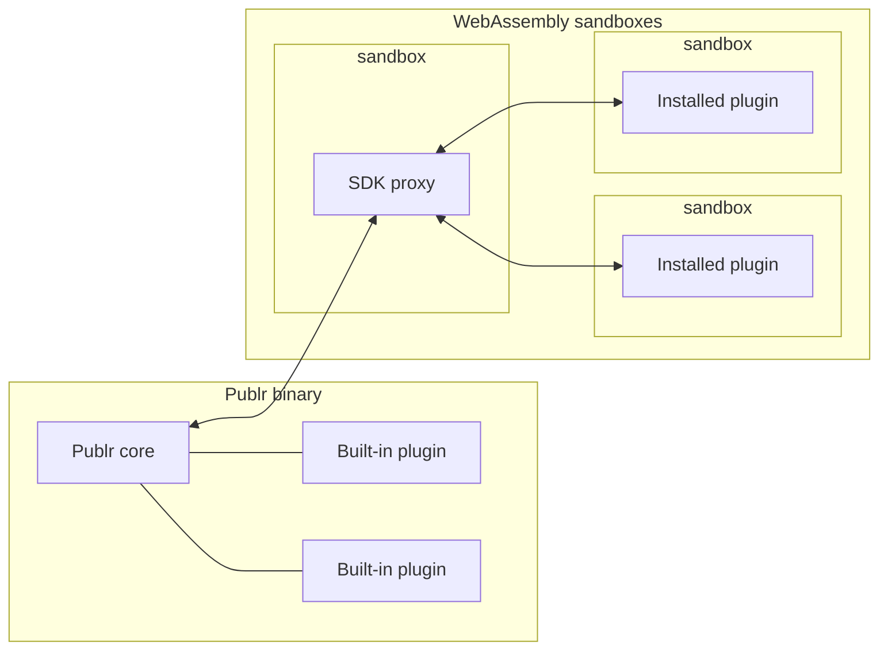
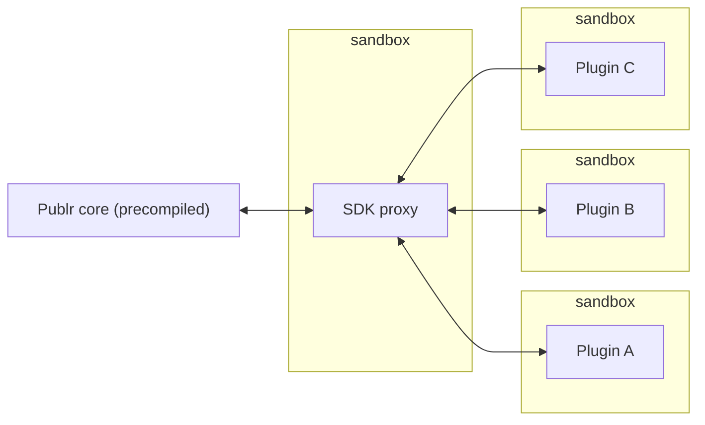

# Plugins

Plugins and apps follow [How to build well](agents.md#how-to-build-well).
Every declaration and its shape is listed in the [Plugin API reference](plugin-api.md).

Publr has two ways to run a plugin. Both use the same SDK. The difference is
where the plugin lives and who decides that it is there: every plugin is either
**built-in** (compiled into the binary, locked: it cannot be disabled) or **installed**
(loaded at runtime into the sandbox: enabled, disabled and removed from the admin). The same
source builds either way. In the code a plugin's mode is `native` or `sandboxed`, and what
its operations and hooks take (`*publr.Ctx`) makes direct calls for a native one and sends
every call to the host as a message for a sandboxed one.



## Built-in plugins

A built-in plugin is placed into the Publr binary by a developer or a
build tool. The result is a tailored Publr: one binary with every battery
someone decided to put inside.

From the user's point of view these plugins are core features. They cannot
be disabled, removed or updated from the admin. Updating one means updating
the plugin source and building a new binary.

This is sometimes called **agency mode**: a software agency prepares the
build for a client, so what the client gets is stable, has every feature they
need, and just works. Only a competent operator decides what goes in, which
makes this setup very safe and resilient.

Two things follow from being inside the binary:

- **Full access.** A built-in plugin can reach the whole Publr API and any
  internals. Whoever builds the binary is responsible for checking it.
- **Deep integrations are possible.** Some plugins must be compiled in because
  they need things the SDK does not expose to the outside: swapping the
  database, adding database extensions, replacing the cache layer, and other
  advanced hooks.

A plugin that uses only the public SDK can be shipped both ways: compiled in,
or as an installed plugin. Whatever it does installed, it does the same compiled in, and
`zig build verify-full` proves it for every test plugin (see
[Build: Two-mode check](contributing/build.md#two-mode-check)).

## Installed plugins (DLP)

Installed plugins are the opposite. They are added from the admin, without
recompiling anything. Think of them as dynamically linked plugins, in the
spirit of DLLs, hence DLP.



Each installed plugin is a precompiled WebAssembly module running in its own
sandbox. It never touches Publr directly: every call goes through the SDK
proxy, which dispatches through the same operation pipeline everything else uses. That gives:

- **An enforced boundary.** The plugin can only do what the SDK exposes and
  what an administrator granted it.
- **Isolation.** A buggy plugin cannot crash Publr or read another plugin's
  memory. A call that loops or grows past its limits stops, and only that call fails.
- **No recompilation.** Install, update or remove a plugin from the admin or
  the CLI, and it just works. Publr stays one binary.

Installed plugins are managed under Settings > Plugins in the admin, and with `publr plugin`
([CLI](cli/plugin.md)). The Built-in tab lists the built-in plugins beside them. Each has
the same page as an installed one, read only: what it asks for (all granted), its data, its
log. A build puts those there, and only a new build changes them, so nothing on it enables,
grants, updates or removes. Added, an installed plugin
is listed and runs nothing; **enabling** it shows what it asks
for and starts it; disabling stops it and keeps what it was granted. What it does, it
does as itself: every call it makes is authorized as the plugin, with the permissions it
holds now. When it acts for someone (an editor calling its operation, a hook on their
save), each call gets the narrower of its permissions and that person's roles.

A newer module for a plugin already there does not replace it: it waits as the
plugin's next version. **Updating** shows what the new version asks for beside what the
plugin holds, then runs it; the version it replaces is kept, and **rolling back** returns
to it (and keeps the other in turn). A module that does not load in the sandbox is never
added.

### Permissions

A plugin asks for permissions in `define`'s `.permissions`: a key, what it narrows to,
yes/no flags, and a reason. They are requests: the administrator sees the sentence, the
reason, the types it names, the key, a switch for the key and one per flag, and a tier
that follows the flags left on, before enabling the plugin. The plugin runs with what it
got, and `ctx.grant("records.write")` tells it whether the key is on and with which flags.

```zig
.permissions = &.{
    .{
        .key = "records.write",
        .records = &.{"products.variant"},
        .publish = true,
        .reason = "Puts the supplier's new prices live",
    },
    .{
        .key = "http.fetch",
        .domains = &.{"api.supplier.com"},
        .reason = "Downloads the supplier's price list",
    },
},
```

| Key | Narrowed by | Flags | Tier |
|---|---|---|---|
| `records.read` | `.records` | `.drafts`, `.private`, `.internal` | low; medium with drafts, high with private or internal |
| `records.write` | `.records` | `.publish` | medium; high naming no type |
| `records.destroy` | `.records` | | high |
| `project.put` | | | high |
| `terms.read` | `.taxonomies` | `.drafts`, `.private`, `.internal` | low, rising as `records.read` |
| `terms.write` | `.taxonomies` | `.publish` | medium |
| `schema.read`, `schema.write` | | | low, high |
| `users.names`, `users.read`, `users.write` | | | low, high, high |
| `site.read` | | | low |
| `settings.write` | | | high |
| `http.fetch` | `.domains` | | high |
| `mail.send` | | | high |
| `media.read` | | `.private` | low; high with private files |
| `media.write` | | | medium |
| `messaging.send` | | | medium |

What each opens:

- `records.read` starts at what an anonymous visitor sees: published records of public
  types. `.drafts` opens drafts, pending changes and version history; `.private` content
  types marked Private; `.internal` other plugins' internal records. Naming types in
  `.records` covers those types whatever their kind; `.drafts` applies either way. A list
  or a query spanning several types answers each by its own grant: drafts of the types the
  plugin reads drafts of (or writes), live records only of the rest.
- `terms.read` does the same for terms: live terms of public taxonomies; `.drafts` draft
  terms, `.private` taxonomies not marked Public; naming them in `.taxonomies` covers
  them whatever their kind. `.internal` is for internal taxonomies, which core does not
  have yet. `terms.write` reads the taxonomies it writes, draft terms included.
- `records.write` reads the types it writes, drafts included. Without `.publish`, creating
  starts a record in its first status, changes to a published record wait as pending
  changes, and a transition into or out of a published status answers `.pending` for
  someone who may publish to approve; with it, they go live. Private and internal types
  only when named. `records.destroy` alone removes a record for good.
- `project.put` is for plugins keeping copies of a project in sync (rollbacks, merges):
  `project.put` puts anything it stores (records, internal records, terms, content types,
  taxonomies, field groups, roles, users, installed plugins' rows) exactly as another copy
  keeps it, ids and history kept; records and terms land as the same change made by a
  person would. Rows only, never files.
- Queued work (jobs, `on` hooks) runs with the plugin's own grant, `.publish` included.
- `messaging.send` lets a plugin emit message events (`publr.messaging.Email`, `Sms`,
  `Push`) beside its own; without it a message is not sent and the write fails.
- `mail.send` lets a plugin hand an email to an SMTP server it names, from queued work only
  (`publr.operations.mail.Send`, [mail](cli/mail.md)): how a messaging provider reaches a
  site's own mail server.

A `call:<plugin>.<verb>` key, for another plugin's operation, and `ai.progress` pass as
they are. Any other key, or an option its key does not take (`.domains` on
`records.read`), fails the build. They are requests: the administrator sees each with its
flags as switches, may switch a flag or the key off before enabling and at any time after,
and `ctx.grant(key)` says whether the key is on and with which flags. A switched-off flag
shows in answers (`.pending`, `Denied`, a query finding nothing), never as a crash.

Some operations no permission names, so no plugin ever reaches them: signing in and out,
passwords and set-password links, who may sign people in, setup, roles, saved views, the
project's secrets, a person's conversations with a model. A
plugin always reaches its own operations (`<name>.*`, `app.<name>.*`), its own content
types' records, its taxonomies, settings and internal records without asking. A compiled-in
plugin is granted what it asks for, as asked; its code's calls are held to it whoever it
runs for, the same as an installed plugin's.

Any key or flag can be switched off at any time; the plugin's next call answers `Denied`,
`.pending` or finds nothing, and it must carry on without. A key nothing installed provides is shown
as unavailable: the plugin runs without it.

### Calling out, and secrets

A plugin granted `http.fetch` sends requests with `ctx.call(publr.operations.http.Fetch,
...)`: to the domains its request names in `.domains` (exact, `*.example.com`, or `*` for
any public address), over https, or in development plain http to this machine when listed;
in production never a local or private address or the server itself (by name or by
address), compiled in or installed. Where the server's host sets `PUBLR_EGRESS`, calls
leave only through it: `off` refuses every one (the host keeps the site offline), and
`<host>:<port>` sends each through the host's egress proxy (TLS on `port`, plain http on
the one above, to ports 443 and 80 only), which looks the name up and checks the
addresses itself. `ctx.grant("http.fetch").domains` is the list as
granted now; an update's new domains join it when the administrator allows the update. A key it needs is a **secret it names but never holds**: it
declares its secrets as a struct, each field one secret, its `///` what it is and where to
find it, and writes `{secret:NAME}` where the value goes, in the address, a header or the
body:

```zig
/// Secrets this plugin uses; an administrator fills them in.
const Secrets = struct {
    /// Supplier API key
    ///
    /// In the supplier's dashboard under Settings › API › Keys.
    SUPPLIER_API_KEY: publr.Secret,
};

// in define: .secrets = Secrets,
```
Declaring is the request: a secret is not a permission. The plugin uses exactly what it
declares; a `{secret:NAME}` its code writes without declaring it fails the build, and one
made at run time is refused (`SecretNotDeclared`). A plugin with secrets asks for
`http.fetch` or `mail.send`, the only ways one is sent. At install each secret's field sits
under the first of those requests with its label and where to find it: optional, filled later on the
plugin's page, which says what is still missing; once set it shows "Set" (or "Set, shared
with" the other plugins naming it) and Replace, never the value. Names are site-wide:
plugins naming `OPENAI_API_KEY` share one value. `PUBLR_SECRET_KEY` and
`PUBLR_SECRETS_FROM_ENVIRONMENT` are never a secret's name. The value is filled in as the request
leaves, and put back as `{secret:NAME}` wherever the answer echoes it. It comes from the
environment variable of the same name when a built-in plugin declares it or the server
lists it in `PUBLR_SECRETS_FROM_ENVIRONMENT` (names separated by spaces or commas; an
installed plugin names its own secrets, so for one a variable not listed is never read),
else from what an administrator set (on the
plugin's page or under Settings › Secrets, [`secret`](cli/secret.md)). With no value the
request is refused in words: "Supplier API key isn't set" (`SecretMissing`).

### Model providers

A plugin becomes a model provider by registering a provider of core's `ai.model` contract
(`publr.ai.contract`, through `.register_providers`) with two operations of its own, made
with `publr.operation.define` as any: `describe_provider`, answering who it is (its label,
models, default model, and its key: the secret it is kept under, where it is made, what to
do there, how it starts), and `complete`, whose run hands its `request` to
`publr.ai.completed(ctx, in.request, complete)`, where `complete` turns a
`publr.ai.Request` into a `publr.ai.Response` by calling its API through `http.fetch`. Core lists every provider of
the contract that is on under Settings › AI, and has a conversation's agent
call the one chosen, in the agent's own process. Publr's official providers are published at
`https://plugins.publr.app` (a `catalog.json` and the built modules it lists;
`PUBLR_PLUGIN_CATALOG` names another folder or address). From the web, a module is
installed only when its version's manifest carries the signature of Publr's plugins key and
names the module's SHA-256 and size; any other is refused (`NotSigned`). A folder is read as
it is. The Overview and Settings › AI
install the ones ticked: each module is added, as uploading it does, enabled, and granted
its requests out, its key and its raised limits, so the key pasted next is all it needs.

A message's parts are text, tool calls, tool results and images (a media type and base64
bytes: screenshots the agent takes, pictures the person attaches); in a tool message the
images follow the results. A provider sends each in its API's own shape. Pictures make a
request a few MiB, so providers ask for more memory than the default (`limits`), and
`http.fetch` sends up to 8 MiB. A provider that streams reads the reply with `http.stream`
and `http.read` and passes the words on with `publr.ai.Progress` (`ai.progress`, a
permission of its own) as they come; `publr.ai.Events` splits the stream into its
`data:` lines.

A provider that turns speech into text says `.speech = true` in its description and adds a
`transcribe` operation as its `transcribe` part, answering
`publr.ai.transcribed(ctx, recording, transcribe)`: a recording (base64 audio,
up to 768 KiB, and its media type, `audio/webm`, `audio/ogg`, `audio/mp4`, `audio/wav` or
`audio/mpeg`) in, its words out. Core's [`ai transcribe`](cli/ai.md) calls it. A file goes
to an API as a form upload: `http.fetch`'s `form`, whose file parts are base64, is written
as `multipart/form-data` by core, so a plugin never encodes one.

### Messages

Publr sends nothing on its own. A plugin sends a message by emitting one of core's message
events, which needs `messaging.send`: `ctx.emit(publr.messaging.Email, .{ .to, .subject,
.text, .html })`, `publr.messaging.Sms` or `publr.messaging.Push`. From the queue, once the
write committed, core hands it to the first provider of its `messaging` contract
(`publr.messaging.contract`) that is switched on and covers the channel. With no provider
nothing is sent and nothing fails. A provider registers `channels` (the channels it covers)
and `send` (one `publr.messaging.Message`), and `attachments` when it sends files; its
`send` runs from the queue, so it may call out: through `http.fetch` to an email service's API,
or through `mail.send` to an SMTP server.

An email is `transactional` (a receipt, a password link) or `marketing` (a newsletter, a
reminder): `.stream`. A provider whose `channels` answers `streams` takes only those, so bulk
mail can go through a bulk provider and receipts through another. A marketing email names
where to stop it (`.unsubscribe`, a signed link): core writes `List-Unsubscribe` and
`List-Unsubscribe-Post` (one click) on it, and refuses one without. `.from` and `.reply_to`
are per message (empty: the provider's own); `.preheader` opens the HTML hidden;
`.reference` (an order's id) is kept with the provider's id for the message. Files are the
site's own media by id (`.attachments = &.{.{ .name, .media }}`, which needs `media.read`):
core hands the provider their bytes, base64, with their type, never an address to fetch.
`.sender` is the plugin that emitted the message, written by core as it is emitted (any
value the plugin gave is replaced); empty for Publr's own.

**Testing emails.** On a development site, install the `email_inbox` plugin (Local inbox):
a provider that sends nothing and keeps every message on the site, read under Local inbox
in the admin or with `publr email_inbox messages --to ada@example.com --subject "order"`.
It keeps messages only where core would move a test clock (on this computer, served over
plain http, never hosted or a copy); anywhere else it covers no channel, so mail goes to
the next provider. To try the real `smtp` plugin, run Mailpit or MailHog on this computer
and set it up under Settings › System › Email as server `127.0.0.1`, port `1025`, security
none, no user name; their web inbox is at `http://127.0.0.1:8025`.

A provider reports what became of a message later (its server refused it, the recipient
marked it as spam) with `messaging.feedback` from its webhook's run: core raises
`publr.messaging.Bounced` or `Complained` with the address and the sender's `reference`, for
whoever keeps who may be mailed.

`messaging.render` makes an email's HTML: the site's layout around it (`messaging
set_layout`, HTML with `{content}`), each `{name}` given a value, escaped, its `<style>`
written into the elements as mail apps want, and its text version. A preview sends the
template's sample values.

A copy of the site (an environment or a branch: the process started with `PUBLR_COPY` set)
mails staff accounts alone, never a customer or a visitor.

A link a person opens without signing in (unsubscribe, a cart, an invoice) is signed:
`ctx.sign(intent, subject, expires)` answers a token and its `/_links/<token>` path,
`ctx.verify(intent, token)` the subject. The intent is the plugin's own word, read by it
alone; `link revoke_all` stops every link signed so far. Opening `/_links/<token>` runs the
plugin's operation named by the intent, as the plugin, given `{ "subject" }`; it answers
`redirect` (a path on the site), `file` (the id of a file the plugin made, downloaded) or
`text`.

A plugin makes files (an invoice's PDF, a label, a feed, a CSV export) with
`ctx.make_file("invoices.document", "invoice-FK-1.pdf")`: `write` each part as it is made,
then `done`, and the file is kept as a published file of the plugin's own media type
(`.kind = .media`; private unless the type is public). Staff open a private one from where
the plugin shows it; a buyer opens it through a signed link answering `{ "file": id }`; an
email attaches it by its id with no `media.read`. The plugin holds one 256 KiB piece at a
time, and a file is at most `.limits.file_mib` (4 MiB unless raised).

Settings › Providers lists every contract's providers, compiled in or installed, in the
order they are tried: an administrator switches each on or off, moves it up or down, and
opens its plugin's settings from there (`provider.list`, `provider.set`).

### Visitors' requests

A plugin reads what a visitor brings to the site (a referral code, campaign tags, a consent
cookie) by declaring it and asking for `request.read`, as any permission, at install:

```zig
.request = .{
    .query = .{ "ref", "utm_source" },
    .cookies = .{"consent"},
    .redirects = .{.{ .prefix = "/ref/", .operation = "follow" }},
},
```

Core keeps, for each visitor, the first and the latest landing that brought a parameter some
plugin reads: where they landed, the page that sent them and when. `ctx.call(publr.operations.
request.Read, .{})` answers the plugin's own names of them, the visitor's address now (behind
the site's proxy) and the cookies it declares, from a call the visitor makes. With
`request.redirect` a plugin answers the site's addresses under its prefixes: `/ref/ada` runs
its operation `follow` with `{ "path", "rest" }` (`rest` is `ada`) as the plugin, for the
visitor, and its answer `{ "to", "status" }` (a path on the site; 302 unless it says 301,
303, 307 or 308) sends the visitor on. A redirect's landing is kept like any other.

### How values cross

An installed plugin talks to Publr, and to other plugins, in plain structs. It never writes
or reads text to do it.

- **A value goes as it lies.** The plugin hands over where its struct is and a description
  of how the type is laid out in its build. Publr copies the value out of the plugin's
  memory. The answer is built in the layout the plugin described and written into room the
  plugin makes for it.
- **Publr's own operations take the struct itself.** The input of `record.get` or
  `internal.save` is read straight into the operation's own type, and its answer is laid
  out straight from it. Fields are matched by name, so a plugin built against an older
  Publr still fits.
- **Between two plugins nothing is in between.** What one plugin sends another (a call to
  its operation, a hook's input, a provider's answer) is copied whole out of the sender and
  built in the receiver's layout, fields, enum tags and a union's alternatives matched by
  name. A field only the sender has is left behind; one only the receiver has takes its
  default.
- **A value modifiers change stays laid out.** What a plugin applies with `ctx.mod` is
  copied out of it once and kept as that plugin laid it out. Each modifier gets the values
  built in its own type, fields matched by name, and what it answers is laid over the
  values where they lie: a field it does not have stays, a field only it has travels on to
  the next modifier, a list's items are matched by their `id`, money key by key. The last
  answer is built in the layout of the plugin that applied. It is the same for a plugin
  compiled in. Only `mod apply` from the CLI or REST takes and answers JSON.
- **A field holding nothing is `null`.** It arrives as `null`, never as a missing field.
  Inside a record's document it is left out, as it always was; `publr.fields.save` sends
  `null`, which clears the field.
- **JSON is written once, by Publr, where it is kept or leaves:** a record's document in
  the database, a queued job's input, an event an `on` hook hears, the log, and the answer
  to REST or the CLI.

What a struct handed over may hold:

| In the struct | Where Publr writes JSON |
|---|---|
| a number up to 64 bits, `bool`, text, an enum | the same; an enum is its tag's name |
| an optional, a slice, a pointer to one value, a struct | `null` or the value; an array; the value; an object |
| a tuple | an array |
| a tagged union (`union(enum)`) | `{ "alternative": payload }` |
| a struct that holds itself (a tree's node its children), in a slice or a pointer | nested the same way, 64 levels at most |
| `publr.Money` | `{ "PLN": 12300 }` |
| `publr.Time`, `publr.Account`, a ledger account, `publr.ProviderRef` | its milliseconds, its id, its name |
| `publr.Decimal(n)` | its exact text, `"1.250"` |
| a reference (`publr.record.AnyRef`, a typed one) | its id |
| `publr.operation.Json` | any JSON |

Not a `std.json.Value`, a hash map, a fixed array, an int over 64 bits or an untagged
union: the build says so. A struct of your own that reads its own JSON says how it lies
with `pub const publr_form` (`.inner`: as its one field; `.lone`: its fields, in JSON its
first alone; `.keyed`: its list of pairs is an object keyed by each pair's first field;
`.fields`: its fields, whatever JSON it reads). A field named in `pub const publr_local`
never crosses and comes zeroed.

`publr.operation.Json` is a value whose shape comes with the data: a record's document,
a query's result. In an installed plugin it is bytes read where they lie, not text:

```zig
const facts = try record.document.as(Facts, ctx.arena());        // as a struct
const read = try record.document.read(ctx.arena());              // part by part
const title = if (read.get("title")) |held| held.text() else null;
const document = try Json.of(ctx.arena(), facts);                // from a struct
```

`read` gives a `publr.Value`: `get(key)`, `at(index)`, `items()`, `entries()`, `count()`,
`text()`, `int()`, `float()`, `boolean()`, `is_null()`. `publr.value.Builder` writes one
part by part. An operation whose name is known only when the plugin runs (a contract's
provider) is called with `ctx.call_named(Out, name, in)`: the same structs, no text.

Nothing a plugin says is trusted. Every address, length and count is checked against that
plugin's memory. A description is checked whole before it is used: sizes, offsets, nesting
(64 levels) and the number of parts (4,096) are bounded, and a part may name one it is
inside of only where it lies at an address of its own. A value's addresses are followed 64
deep at most, so a value that points at itself ends the call. A text must be UTF-8, an enum
must hold one of its tags, a union one of its alternatives. A value whose shape comes with
the data is checked whole before any of it is used: every length inside its part, every
count the number of items there, 64 levels of nesting. One value may make Publr read at
most 32 MiB. A request that fails any check ends that call with `Invalid`. Values are always
copied, never shared, and built in zeroed memory, so nothing of Publr's or of another
plugin's lies between the fields. Every call is still authorized and validated as any other.

A modifier's answer is held to the same checks before it is laid over anything. It is
copied out of the modifier whole, at most 200 values and 1 MiB of them laid out; the
layout the values take with its added fields is put together by Publr and read back like
any description. An answer that is not as many values as it was given changes nothing; one
value that cannot lie over what it was given (nothing where the value must hold something,
a number its field cannot hold, a text where it holds a struct) leaves that value as it
was and the others change. A modifier can write the fields it names and add fields of its
own, nothing else: what it does not name is copied from the value as it was.

A page is handed over the same way, once. The plugin's view runs in the plugin and
describes the page: its own markup, and each design-system component it reached with its
props as the struct they are. Publr reads every component's props where they lie, draws
them all natively and answers the finished page, so a page costs one call however many
components it has ([Core draws the page](#core-draws-the-page)).

What still crosses as text: a page's own markup, which is text by nature, and the state a
view seeds for the browser, written as JSON where the view runs; a file's bytes, as base64
in a text; and the plugin's manifest, read once when it is built. Inside Publr, an
operation's input is still written as JSON to read the records it takes by reference, and
where one side of a move or a merge is a value whose shape comes with the data (a record's
document, a `publr.operation.Json` field, the values `mod apply` got as JSON) or a
union, that part is read as the tree it stands for, once.

An event is JSON only in the queue. Each `on` hook waits with the fields its own type
names, read from the answer where it lies, so an operation that answers a megabyte still
reaches a hook that reads its id ([Plugin API: Hooks and events](plugin-api.md#hooks-and-events)).

### Core draws the page

`publr.views.render(ctx, base, View, props)` answers a page's HTML the same either way a
plugin runs. Compiled in, the view and every component draw in the process. Installed, the
plugin carries no design system:

1. The view runs in the plugin. Where it reaches a component (`<Table>`, `<Text>`,
   `<IndexPage>`), nothing is drawn yet: the component's name and props join the page's
   list, and a placeholder (`<publr-drawn n="3">`) is written where it goes. A component's
   children are the plugin's markup too, with placeholders for the components inside them,
   so a tree of any depth is a flat list and no markup is written twice.
2. The page is handed to Publr in one call: the markup and the list. Each component's props
   are read where they lie in the plugin's memory, by the layout the plugin's build
   describes, into the design system's own types.
3. Publr draws every component natively, puts each where its placeholder stands, and
   answers the page.

The view is written as before: any component, nested any way, the plugin's own markup
between them, state and handlers for the browser. Attributes a view puts on a component's
root (a list row's key, `data-part`, a slot's classes) reach the root Publr draws: a class
or a style given again is added to the root's, anything else replaces it.

A page is the plugin's data and is checked as such. A component must be one an installed
plugin may draw, and a prop one of its props with a value of its type (a tone that is not a
tone ends the page with `Invalid`). A placeholder must name a component of the page, and
inside a component's children only one drawn before it, so no page holds itself. A page has
at most 4,096 components, 4 MiB of its own markup and 4 MiB once drawn, its props take at
most 8 MiB, and components nest 64 deep. A plugin's page is shown in the plugin frame, as
before; where a plugin's output goes on a trusted page, it still goes through the sanitizer.

### Reads are walks and pages

A plugin that works over many records walks them: it asks for all of them and loops, and
holds one page at a time whatever their number.

```zig
var lines = Lines.where(ctx, .order, order.id);

while (try lines.next()) |line| {
    total += line.value.amount;
}
```

Underneath, 200 records are read at a time, each page from where the last ended, and given
back before the next is read. What the loop allocates for one row (`ctx.arena()`, a record
it reads for it) is given back at the next row. So a row is good until the next `next`: a
number or an enum copied out of it stays good, text is kept with `lines.keep(text)` and a
whole row with `lines.kept(line)`, both into the memory the walk began in. A walk the loop
leaves early (`break`, `return`) holds its page until the operation or scope around it
ends; `lines.end()` gives it back at once. In a debug build each row is a copy given back
and overwritten at the next, so a row kept past `next` shows in the first test that does it.

- `Lines.where(ctx, .order, id)`: the records whose indexed field holds the value, the oldest
  first; `Lines.all(ctx)` for every record of the type. Shaped before the first row:
  `.newest()`, `.first(10)`, `.as(Shown)` for only the fields `Shown` names.
- `.count()` and `.any()`: how many there are, counted from the index, none read; `.one()`:
  the one record, or null, two being a conflict.

A screen shows a page: it says how many rows it wants, and reads no more.

- `Lines.page(ctx, .order, id, .{ .limit = 10, .offset = 20, .oldest = true })`: a page of
  the internal records whose indexed field holds the value. 50 rows when no limit is given,
  200 at most; the newest first, or with `.oldest` in the order they were made.
- `Lines.page_of(ctx, Shown, .order, id, .{ .limit = 10 })`: the same page, each record with
  only the fields `Shown` names (a struct of some of the record's fields, with their
  types). A list that shows two fields reads two.
- `Lines.where(ctx, .order, id).count()`: how many there are, counted from the index. No
  record is read, so a list can say "10 of 2,000" beside the page it shows.
- `Lines.many(ctx, ids)` and `Lines.many_of(ctx, Shown, ids)`: up to 200 internal records by
  id in one call, never one call an id.
- `publr.ledger.page(ctx, .{ .about = order, .limit = 10 })`: a page of the transfers about
  a record, narrowed by `.reason`, `.account` or `.name` when given. A sum is never added up
  from transfers: `publr.ledger.totals` adds it up in the database, for one record or for a
  page of finer ones (`.details`).
- Content is read with GROQ, which slices and projects itself:
  `*[_type == "notes.note"] | order(_createdAt desc) [0...10] { title }`, and
  `count(*[...])` for how many.

### Lists in an operation hold a page

Every list an operation takes or answers holds at most 200 items, a page, unless the struct
holding it says fewer: `pub const limits = .{ .tags = 20 };` beside its fields. A limit past
200 does not build. An input past its limit is refused before the operation runs, named at
the list (`tags: At most 20`); an answer past it fails the call, the operation's own fault.

What may hold more is answered a page at a time: the operation takes `after: []const u8 = ""`
and answers `next: []const u8`, empty after the last page. A walk hands over its page and
where the next begins:

```zig
fn run(ctx: *publr.Ctx, in: In) publr.Error!Out {
    const page = try Lines.where(ctx, .order, in.order).page_after(in.after);

    return .{ .lines = try shown_of(ctx, page.rows), .next = page.next };
}
```

A plugin calling such an operation walks its pages, one held at a time, the page before
and what it allocated for it given back at the next:

```zig
var pages = publr.pages(ctx, Lines.operation, .{ .order = order.id });

while (try pages.next()) |page| {
    for (page.lines) |line| { ... }
}
```

The CLI prints every page, one JSON value each, unless `--after` asks for one; REST and
MCP answer the page asked for, with its `next`.

A page of an admin screen shows a page of each list it holds (ten rows is a good start),
with a "Show more" that asks the operation for more rows and draws them in the browser. A
figure a page needs that would mean adding up every record (an order's total, a line's
amount) is kept on a record when it changes, and read from there.

Many amounts on one page are written in one call, `publr.operations.money.Texts` (up to
1,000). The site's currencies are asked for once in a call, however many amounts are
written, whichever of `money.text` and `money.texts` writes them.

### Limits

Every call into a plugin runs within limits: 100 ms of CPU (counted in instructions),
16 MiB of memory, 1,000 calls of its own, 1 MiB of output, files it makes of 4 MiB. A
plugin that needs more asks in `define`'s `.limits`, with a reason; each raised limit is a
high-tier request. The CPU limit counts everything a call runs in the plugin, calls nested
in its own included. A plugin is started at most once for a request and that instance is
gone when the request ends; a call that traps or goes over a limit drops it at once. A
plugin keeps nothing between calls but what it stores
([reference](plugin-api.md#permissions-secrets-limits)).

Going over a limit is never quiet. An operation that goes over fails. A modifier that goes
over refuses the apply and the operation that asked for the value (`ModifierFailed`). A
`before` or `after` hook on an operation that goes over refuses the write. Two hooks cannot
stop what they hook, by design, and say so instead: one that only adds fields to a list's
rows leaves them out (a list every screen reads never fails for one plugin's column), and
one on an event that cannot be refused (signing out, an administrator signing in) lets it
go on. Either failure is a warning line under the call in the Activity or Error log and on
the plugin's Log, and in the server's log. Neither changes what the hooked call stores; a
write the hook itself finished before it failed was a whole operation of its own and stays. Publr's own working memory for a call
is bounded too (4 MiB for the deepest path of nested calls): each call a plugin makes gives
its memory back as it answers, and a call that still runs out fails with `OutOfMemory`. It
is never run a second time.

A plugin compiled into the build holds memory the same way. Publr sets one piece of memory
aside for all compiled-in plugins' work: 32 MiB, an installed plugin's 16 MiB in the layout
a compiled-in plugin has, where an address and a length are twice as wide. Each piece of
work (an operation, a hook, a modifier, a job, a call to another plugin, a
[`ctx.scope()`](plugin-api.md#memory-for-one-step-ctxscope)) takes whole pages of it and
gives them back as it ends; what it answers is copied to its caller's memory first. A
record read or written through the SDK is one such step: the JSON it is stored as goes
back with it, and the caller keeps its own structs. The calls a plugin makes to Publr's own
operations run in Publr's working memory, as an installed plugin's do. The request's own
memory then holds what lasts the request, never a plugin's working data. A piece of work
that runs out of the plugins' memory fails with `OutOfMemory`. Two kinds of work stay in
their caller's memory: an operation whose answer cannot be copied whole (it points at
something else, as a list's open rows do), and a hook that takes a value it could change
where it lies (a list that is not constant).

Running out of memory, and coming close, are named. A plugin's own collections
(`publr.List`, `publr.IdMap`, `publr.IdList`) tell Publr how much they hold as they grow. A
plugin that runs out of memory leaves a line on the call's Error log entry naming the
largest collection it made in the request and what it held:
`sampler.hoard ran out of memory (it may hold 16 MiB); the largest collection it made, a
publr.List of operations.hoard.Kibibyte, held 14048 KiB`. A request that leaves a plugin
holding more than half of what it may (or the compiled-in plugins more than half of theirs)
writes a warning to the server's log, naming the request and that collection: a warning
before the limit, so a plugin whose memory follows its data is seen before it fails.

### What a request cost

Publr counts what plugins cost in every request (an HTTP request, a command, a queued
run): for each installed plugin the instructions it executed, its calls into Publr, how
often it was entered, the instances made for it and the most memory it held; for the
compiled-in plugins together the pieces of work they began and the most memory they held;
and Publr's own working memory at its fullest. Start the server or run a command with
`PUBLR_COUNTERS=1` and each request that reached a plugin writes its lines to the process's
error output:

```
counted orders.place_for plugin=orders instructions=1320114 host_calls=412 invocations=3 instances=1 memory_kib=2560
counted orders.place_for plugin=tax instructions=864445 host_calls=201 invocations=2 instances=1 memory_kib=832
counted orders.place_for plugin=* instructions=2184559 host_calls=613 invocations=5 instances=2 memory_kib=2560
counted orders.place_for core scratch_kib=1120 arena_kib=721 db_kib=5725
```

The second word names the request: the operation a command called, `post_/path` for an HTTP
request, the job or event of a queued run. `plugin=*` adds the installed plugins up
(`memory_kib` is the largest one's). `scratch_kib` is the working memory for nested calls
(4 MiB at most), `arena_kib` the request's own, `db_kib` the most SQLite held during it (of its
64 MiB; counted only while `PUBLR_COUNTERS` is set). A request in which compiled-in plugins
worked has one more line, before core's, and no `plugin=` lines when no installed plugin
ran:

```
counted orders.place_for compiled_in work=7151 memory_kib=4800
```

`work` is how many pieces of work the compiled-in plugins began (an operation, a hook, a
modifier, a job, a scope), `memory_kib` the most they held together. Counting is always on and costs a few additions a call; the
lines are written only when the variable is set. They go to the operator's output alone:
never into an answer, and no plugin can read them.

## Writing a plugin

A plugin is a folder with a `main.zig`. Installed or built-in, it is written the same way,
against the same SDK. Its words are its doc comments, and one registration, last in
`main.zig`, says what it brings:

```zig
//! Entries people add and remove, on a page of its own.
//!
//! List the entries with `notes list`, add one with `notes add`. The page in the admin
//! shows them all.
const std = @import("std");
const publr = @import("publr");

const manifest: publr.Manifest = .{
    .name = "notes",
    .version = "0.1.0",
};

// ... records, operations, hooks ...

pub const plugin = publr.plugin.define(manifest, .{
    .records = &.{Entries},
    .operations = &.{ List, Add },
});
```

- **The words.** The first line of `main.zig`'s `//!` is the plugin's description. Opened
  with a name and a colon (`//! Bank transfer: the buyer pays…`), that name is how the admin
  and other plugins show it ("From Bank transfer"), translated like its other words; the
  rest is the text on its settings page. An operation's words are the `///` above it, or
  its file's `//!`. Every field of a record, an input and an output has a `///`. A
  missing comment fails the build, and says where it goes. `publr plugin build` and
  Publr's own `zig build` read them from the source.
- **The options** are struct fields: a misspelt one fails the build. Every part is written
  out where it is used (`.records = &.{Entries}`, `.operations = &.{List}`); Publr never
  looks inside a file for a name.
- **Decided but not built.** `register_components` is no option of `define` yet, so naming
  it fails the build. Outside search engines and field editors in the plugin frame come
  with later gates too.

### Operations

```zig
pub const AddIn = struct {
    /// The entry's title, 1 to 160 characters
    title: []const u8,
};

pub const AddOut = struct {
    /// The new entry's id
    id: []const u8,
};

/// Adds an entry.
///
/// Administrators, and callers granted `notes.add`.
///
/// Fails:
/// - Full (409): the plugin keeps at most 1,000 entries
///
/// Example:
///   in: { "title": "First" }
///   out: { "id": "0a1b2c3d4e5f60718293a4b5" }
pub const Add = publr.operation.define(AddIn, AddOut, .{
    .name = "add",
    .kind = .write,
    .validate = check_add,
    .run = add,
});

fn check_add(in: AddIn, problems: *publr.Problems(AddIn)) void {
    if (in.title.len == 0 or in.title.len > 160) {
        problems.add(.title, "A title is 1 to 160 characters");
    }
}

fn add(ctx: *publr.Ctx, in: AddIn) publr.Error!AddOut {
    return .{ .id = try Entries.create(ctx, .{ .title = in.title }) };
}
```

- `.name` is the verb; the operation is `<plugin>.<verb>` (`notes.add`). `.kind` is `.read`
  or `.write`; a write runs in a transaction.
- The words: the first line is the description, then the details, then `Fails:` (each
  `- Name (status): what it means`; the status is 409 when left out, any 4xx but 401 and
  429), then `Example:` with an `in:` and an `out:` line of JSON. The example is read into
  the operation's types when it compiles and is what `--help` shows.
- `.authorize` says who may call. Left out: administrators, and roles an administrator
  granted the operation; with `.untrusted_callers = true`, anyone. A ready answer is data
  a site can read: `publr.authorize.user_is_signed_in` (needs `.untrusted_callers`),
  `user_has_role(&.{"editor"})`, `plugin_calls`; the host checks it before anything runs.
  Or a function of the plugin's own, `fn (ctx: *publr.Ctx, in: In) bool`, run first in
  the call. Administrators pass every ready answer, except through an app's address.
- `.untrusted_callers = true` lets anyone call it without credentials: a site's pages,
  and any script anywhere. Treat its input as untrusted, key data to the caller, answer
  with nothing of other people's. `.public_api = true` lists it in the published API
  reference and changes nothing about who may call.
- `.validate` reports every problem at once with `problems.add(.field, "reason")`; the call
  is refused as `Invalid` (422) with a `problems` list, each beside its field. Records check their own data; `.validate` is only for
  what belongs to the call.
- `.destructive = true` says it erases for good.
- `.deprecated = .{ .since = "0.4.0", .removed_on = "2027-03-01", .instead = "notes.save",
  .migration = "Send `text` as `body`." }` marks it on its way out: it keeps working until
  `removed_on` (a day, `YYYY-MM-DD`), every caller is told, `--help` and the REST headers
  say so, and `migration` is what a release's migration prompt says of it. `instead` names
  an operation that is not deprecated itself; `migration` is required. `plugin surface`
  lists core's deprecations; `zig build deprecations -- --before <day>` lists Publr's own.

A site's pages call an operation at `<mount>/_actions/app.<plugin>.<verb>`: forms, islands
(JSON with `Publr-Request: 1`), and `Publr.request.call('app.<plugin>.<verb>')` in a page's
frontmatter. Through that address an administrator is a signed-in person like any other,
and an operation without `.authorize` is never reached.

### The context

`run` takes `ctx: *publr.Ctx`:

| Call | What it does |
|---|---|
| `ctx.call(Operation, in)` | any operation, through the same checks as every caller; its own definitions too (`ctx.call(Add, ...)`) |
| `ctx.fail(.Name, "Only {left} left", .{ .left = left })` | refuses in the plugin's words, translated, with the status its `Fails:` line gives; the write rolls back |
| `ctx.t(text, values)`, `ctx.tn(one, many, count, values)` | text for people in the caller's language |
| `ctx.translate(label)` | words marked where they were written (`publr.t`, another plugin's `ctx.t`) and kept as written, such as a label another plugin stored, in the caller's language |
| `ctx.log(.info, "Charged {s}", .{amount})` | a log line with a level (`.info`, `.warn`, `.err`): under the call in the Activity log or Error log, and on the plugin's Log tab |
| `ctx.now()` | the call's time as `publr.Time`, the type of `datetime` fields; on a test site, the time `project set_clock` moved it to, as queued work's moments are ([CLI](cli/project.md)) |
| `ctx.caller()` | who calls: `.from`, `.visitor`, `.referer`, `signed_in()`, `has_role(name)`, `granted()`, `is(id)` |
| `ctx.grant(key)` | whether a permission is on, its flags, and (`http.fetch`) its domains |
| `ctx.emit(Event, payload)` | emits an event: `after` hooks now, `on` hooks from the queue once the write commits |
| `ctx.arena()`, `ctx.alloc(T, n)`, `ctx.print(fmt, args)` | memory freed when the call ends |
| `ctx.scope()` | memory of its own for one step, given back at its `end()`: a call with several large steps takes the memory of the largest ([reference](plugin-api.md#memory-for-one-step-ctxscope)) |

### Records

```zig
/// Post
///
/// An article: its own page under /posts, listed newest first.
pub const Post = struct {
    /// Title
    title: []const u8,
    /// Slug
    slug: ?[]const u8 = null,
    /// Body
    body: ?[]const u8 = null,
};

pub const Posts = publr.record.define(Post, .{
    .name = "blog.post",
    .public = true,
    .url = "posts",
    .fields = .{
        .slug = .{ .kind = "slug", .options = .{ .source = "title" } },
        .body = .{ .kind = "richtext", .searchable = true },
    },
});
```

The struct is the record: its `///` is the type's name and description, each field's its
label and help. Kinds follow the Zig types (text, integer, number, boolean, `publr.Time` a
datetime, an enum a select, a `Posts.Ref` or `publr.record.AnyRef` a reference, a
`publr.ProviderRef(Contract)` one provider of a contract, see
[Contracts and providers](plugin-api.md#contracts-and-providers), a `publr.Account` a
person's account, a `user` field kept as the account's id, never an id in a text field:
`ctx.caller().account()` is the signed-in person's); a field
without a default is required. `.fields` overrides a field's kind, its rules
(`.validation = .{ .max_len = 280 }`, checked on every write whoever writes, and shown
beside the field's help) and its options (how it is edited). `.internal
= true` makes it the plugin's bookkeeping (internal records, never in the admin's content
list), with `.indexed` for the fields it is found by (`&.{.page}`); it runs the same rules
on every write, and a `.unique` value (a transfer's id) is held once, so the same write sent
twice is a conflict. `.visibility` keeps a field to its plugin and named roles (`.restricted`,
or `.special` for health data). The name is the plugin's
and the type's, `blog.post`: apps, GROQ, `--type` and other plugins use it whole. A
`.validate = fn (Post, *publr.Problems(Post)) void` checks rules across fields on every
create and save, whoever writes; a write of many records (`create_many`, `save_many`) is
checked in one go, and a plugin is started only for a write of its own kind of record. Other options: `.title_field` (a field, `.title`),
`.public`, `.url`, `.plural_name`, `.menu`, `.editor`, `.kind`, `.app`. The handle reads and
writes typed values: `Posts.get(ctx, id, .{})`, `Posts.find_one(ctx, .slug, "hello")`,
`Posts.create(ctx, value)`, `Posts.save(ctx, id, fields, .{})`.

A record declares its statuses and the transitions between them:

```zig
pub const GreetingStatus = enum {
    /// Draft
    draft,
    /// Shown
    published,
};

const greeting_flow = [_]publr.record.Transition(GreetingStatus){
    .{
        .name = .publish,
        .from = &.{.draft},
        .to = .published,
        .label = "Show",
        .authorize = publr.authorize.user_has_role(&.{"editor"}),
    },
};

pub const Greetings = publr.record.define(Greeting, .{
    .name = "hello.greeting",
    .status = .{
        .list = GreetingStatus,
        .start = .draft,
        .flow = &greeting_flow,
        .published = &.{.published},
    },
});

// a record changes status only by a named transition:
const held = try Greetings.get(ctx, id, .{});

if (held.status == .draft) {
    _ = try Greetings.transition(ctx, held, .publish);
}
```

`create` starts a record at `.start`, which is required. A transition names the statuses it
leaves (`.from`, or `publr.record.any`), the one it reaches, and may say who makes it
(`.authorize`, refused to anyone else on every path that moves a record). Every flow also
has core's `trash` and `restore`. Core's `draft`, `published` and `archived` keep their
meaning; a record's own statuses are stored under its plugin's name (`hello.in_review`).

Anything more than one record by id or one field is a GROQ query, never a query language
of Publr's own:

```zig
const greetings_so_far = publr.query.prepare(
    \\count(*[_type == "hello.greeting"])
, .{});

const rows = try greetings_so_far.execute(ctx, u32, .{});
```

A query's `$names` are bound from the struct `execute` is given and never written into the
text; a `$name` the struct lacks, or a field the query never names, fails the build. It
reads as the caller, with their access applied, and leaves trashed records out.

#### Computed fields

A field of an internal record can be worked out by the plugin instead of written by a
caller. Publr stores it with the record and works it out again only when something it
read has changed:

```zig
pub const Line = struct {
    cart: Carts.Ref,
    item: publr.record.AnyRef,
    quantity: u32,
    /// Priced: what its item costs, worked out by `priced`
    priced: Priced = .{},
};

pub const Lines = publr.record.define(Line, .{
    .name = "shop.line",
    .internal = true,
    .indexed = &.{.cart},
    .fields = .{
        .priced = .{
            .kind = "virtual",
            .options = .{
                .virtual = .{
                    .computed = priced,
                },
            },
        },
    },
});

fn priced(ctx: *publr.Ctx, line: *const Line) publr.Error!Priced {
    const product = try Products.get(ctx, line.item.id, .{});

    return .{
        .total = product.value.price * line.quantity,
    };
}
```

- Reading a line gives the stored value. You never call `priced` and never say what it
  depends on: Publr notes every record, list and operation it read (another plugin's
  reads too, when it asks one). A change to any of them makes the value stale, and the
  next read works it out again before it answers. Values are always fresh.
- A create or save of the line works its values out in the same write. What a caller
  sends for a computed field is ignored.
- The function only reads. It gets no reader: no person signed in, no visitor, no
  cookies, the main language, live records only. A value is stored once for everyone, so
  whatever it depends on must be on a record (a cart keeps its account's roles).
- The clock is not a read. When an answer stops holding at a time (a sale ends), say so:
  `try ctx.holds_until(sale.ends)`. It is worked out again then.
- Every computed value goes through the mod `<record>.<field>`, `shop.line.priced`, so any
  plugin can change it with `publr.modify` (see [Hooks, events and other
  plugins](#hooks-events-and-other-plugins)). Installing, removing or updating such a
  modifier makes the values stale.
- Totals are added up by Publr, a page at a time, never handed over as a list:
  `Lines.where(ctx, .cart, id).sum("priced.total")`.
- A computed field is never indexed, at most 8 per record. Computed fields are on
  internal records only.

### A ledger

Counted balances (store credit, points, what a buyer owes, what a shop owes a partner) go on
core's double-entry ledger, not in records: a plugin declares its account names, reasons and
units once with `publr.ledger.define`, lists it as `.ledger`, and moves its own accounts with
`Ledger.transfer`, `hold`, `post_hold`, `void_hold`, `chain`, `reverse` and `convert`. A
transfer's id is the plugin's own, so a retry is harmless; limits are checked inside the
write; a refused chain undoes only itself. Another plugin's accounts are moved only when that
plugin hands one over by calling, and read with the `ledger.read` grant naming it. People see
each plugin's accounts on its Ledger tab and every plugin's in Settings › Ledger, read only.
The whole API is in [Plugin API: The ledger](plugin-api.md#the-ledger).

### Hooks, events and other plugins

```zig
/// A greeting was recorded.
pub const Recorded = publr.event.define(.{
    .name = "recorded",
    .payload = struct {
        /// The greeting text
        note: []const u8,
    },
});

fn announce(ctx: *publr.Ctx, in: *RecordIn, out: *const RecordOut) publr.Error!void {
    ctx.emit(Recorded, .{ .note = in.note });
}

/// Thanks whoever wrote it, once the greeting is kept
fn thank(ctx: *publr.QueueCtx, recorded: Recorded.Payload) publr.Error!void { ... }

// in define:
.hooks = &.{
    publr.after(Record, announce),
    publr.on(Recorded, thank),
},
.events = &.{Recorded},
```

A hook names what it hooks by type: an operation of the plugin's own, one of
`publr.operations`, a remote, or an event, and a named function. `before` (operations only)
sees and may change the input, `after` sees the answer or the payload inside the write and
may refuse, `on` hears it from the queue once the write committed: an operation's answer as
it was, or the event's payload. Every operation emits its own event on success; a plugin's
event is for something that happens that is not a call; its payload is typed, and it is
named `<plugin>.<name>`. An event takes `.deprecated` as an operation does. An `on` hook
can't refuse: one that fails runs again on its own, as
a failed job does (a minute later, doubling, eight runs in all), and after the last it shows
failed on the plugin's Log and in `publr job list`; the record and the person's values stay.

A plugin never imports another. It describes another plugin's things with only what it
uses, checked against the real ones: `publr.remote.operation("newsletter.subscribe", In,
Out)`, `publr.remote.record("products.variant", Fields)` (a typed handle on another
plugin's records, still needing a `records.*` permission), `publr.remote.event(name,
Payload)`. The plugins it needs go in `.depends_on` (`"newsletter@^1.2"`), the ones it uses
when present in `.compatible_with`.

### Field kinds and fields on other records

```zig
/// Location
///
/// A point on a map, with its address.
pub const Location = struct {
    lat: f64,
    lng: f64,
    address: []const u8,
};

// in define:
.field_kinds = &.{publr.field.kind(Location, .{ .name = "location", .validate = check })},
```

The kind is named under the plugin (`places.location`); its storage follows the value (a
struct is kept as JSON), its words are the `///` on the value, and `.validate` runs on
every write. Until editors reach the plugin frame, the form shows such a value as JSON.

`.register_fields` puts a group of fields on users, media or any type, placed with core's
location rules:

```zig
.register_fields = &.{.{
    .fields = Points,
    .location = &.{.{ .rules = &.{.{ .field = "destination", .value = "user" }} }},
}},
```

Placed on another plugin's type (`destination` `content` and the `type`), the group is a
field of each record's own document, under the group's name (`shipping: { weight }`):
saved, versioned and published with the record, shown in its form, read by whoever reads
the record. A field whose value is one of the plugin's own kinds takes that kind; a kind
made with `.code_only = true` is never offered in Structure, so only the plugin puts it on
a type. The type itself never stores the group: it goes when the plugin's group goes.

```zig
// The plugin's kind: `publr.field.kind(Weight, .{ .name = "weight", .code_only = true })`.

/// Shipping
pub const Fields = struct {
    /// Weight
    weight: ?Weight = null,
};

.register_fields = &.{.{
    .fields = Fields,
    .location = &.{.{ .rules = &.{
        .{ .field = "destination", .value = "content" },
        .{ .field = "type", .value = "products.product" },
    } }},
}},
```

### Checks

`publr plugin check --dir <folder>` reads a plugin's source for what the rules forbid and
the compiler cannot see: money kept as a plain number (`total: u64`), a time as a number
(`created_at: i64`), a reference as text (`product_id: []const u8`), JSON in text
(`extras_json`), an untrusted write taking facts the server owns (a price, a total), an
import reaching outside the plugin's folder. A `Why:` line in the field's `///` passes a
name check and shows to whoever reviews the plugin. `plugin build` and Publr's `zig build`
run the same checks on every plugin registered through `define`, and fail on what they
find.

### What an installed plugin asks for

On top, an installed plugin says what it needs, in `define`:

```zig
.permissions = &.{.{ .key = "users.names", .reason = "Greets the people on the site by name" }},
.limits = .{ .cpu_ms = 2000, .reason = "Resizes images" },
.depends_on = .{"newsletter@^1"},
```

A plugin never writes `export fn`.

### Panels on edit forms

A plugin can add a box to any content type's edit form, its own type, another plugin's,
or the core's, without that type's plugin knowing about it:

```zig
// in define:
.panels = &.{.{ .type = "product", .label = "Stock", .operation = StockPanel }},
```

`StockPanel` is one of the plugin's reads, taking `record` (the record's id) and `base`,
answering `html` drawn by its own view: `publr.views.render(ctx, in.base,
publr.views.all.StockPanel, props)`, a `ui/StockPanel.ptsx` on the `PanelPage` layout,
which draws what the panel shows and nothing around it. The admin shows it in the editor's right column, titled with its label
and the plugin's name, in the plugin frame sized to its content; `call` and `query` work
in it as on the plugin's pages. It is told only which record it is on and reads the rest
itself, within what it and the viewer may. It shows to whoever may call the read, on
records of that type, and not at all when the type is not there.

### Menu items, the top bar, and what a plugin says about itself

The admin's menu is built from menu items. A plugin declares its own, and its records (and
other plugins' records and items) sit under them by naming them; the item's plugin never
knows who sits under it. An item whose parents do not exist is a part of the admin of its
own: listed in Content, pinnable to the rail by each person, its children headings in its
sidebar:

```zig
const shop_menu: publr.MenuItem = .{ .name = "shop", .label = publr.t("Shop"), .icon = "products.bag" };
const store_menu: publr.MenuItem = .{
    .name = "store", .label = publr.t("Store"), .icon = "tag", .parent = &.{"products.shop"},
};

// in define:
.menu = &.{ shop_menu, store_menu },

// on a record: the first of these that exists, else where content types go
.menu = .{ .parent = &.{ "products.store", "checkout.orders" } },
```

An item opens one of the plugin's record types' lists (`.record`), one of its pages
(`.page`), or nothing (a heading). The rail is the person's: no plugin adds to it, though an
administrator may pin a page for everyone. A list starts where its type's `.data_view`
says (columns, filters, order); people change it from the view knob, the column headers and
Filter, and keep it as their default or a view. Which fields filter and sort is the fields'
own (`filterable`, `sortable`). A plugin may bring
icons of its own (`.icons`), each drawing sanitized before a page shows it.

A page that says `.top_bar = .{ .count = Count }` is also in the top bar, drawn by the
admin's own components so it looks like its own and passes for nothing else, with the
count a read answers beside its label.

What the plugin says about itself on its page under Settings › Plugins is its `main.zig`'s
`//!` past the first line, through the admin's sanitizer profile, in a box the admin draws
and names after the plugin.

### Pages in the plugin frame

Any plugin, installed or built-in, can bring pages of its own, listed in the Settings
sidebar for whoever may call the read that draws them:

```zig
const log: publr.plugin.Page = .{
    .path = "log",
    .label = "Guestbook log",
    .icon = "stack",
    .operation = Page, // a read: In has `query` and `base`, Out has `html`, all strings
};

// in define:
.pages = &.{log},
```

The page is at `/admin/plugin/<plugin>/<path>`. The admin draws its chrome and puts the
plugin frame in the sheet: an `<iframe sandbox>` with an opaque origin. The frame's
document is the `html` the read answers, run as the person looking at it, with the
address's query string as `query` and the path the project is served under as `base`.

The plugin draws the page with the admin's own layouts, so it looks like any other
Settings page: its view (an `IndexPage`, a `FormPage`) rendered whole with
`publr.views.render(ctx, in.base, publr.views.all.<View>, props)` ([Core draws the
page](#core-draws-the-page)), which leaves out the rail, the sidebar and the crumbs the
admin already draws around the frame, and speaks the person's language: `Publr.t` in the
view reads their catalogue. The frame gets the admin's stylesheet and a small bridge, and
nothing else: no session, no network (`connect-src 'none'`), and it can be framed only
by the admin. Its response carries the same policy, so it stays sandboxed even when
opened on its own.

Inside, anything goes: any markup, any script, any library. The admin's design system
is the easy default. The frame reaches the admin only through the bridge:

- A view's `ctx` (given with its props) has `ctx.person` and `ctx.page`, and in the
  browser `ctx.query("guestbook.entries", () => input)`, a read read again after any
  write, and `ctx.call("guestbook.sign")`, a write: each one of the plugin's own
  operations run as the viewer, through the usual checks. Anything else is refused.
- `ctx.navigate("log?week=2")`, and every link clicked, goes to another of the
  plugin's pages (`?week=2` alone stays on this one) or to an address in the admin
  (`/admin/roles/add`). A link to another site opens in a new tab.
- The frame grows with what it shows.

What the frame draws never reaches the admin, so it needs no sanitizing and no
permission.

`.bare = true` draws the page alone: no rail, sidebar or top bar, the frame filling the
window, for a page that stands on its own, such as a long task's progress on a `CardPage`
(the clone's progress page in the `publr` command is one). It is the same frame page
otherwise: the same sandbox, bridge and checks, shown to whoever may call its read; give
it `.menu = .none` when it should not be listed.

A page can also be a declaration, with no views of the plugin's: `.form = .{ .read =
Read, .save = Save }` instead of `.operation`. The admin
draws it as one of its own pages (no frame: nothing of the plugin's is drawn), a field for
each field of `Save`'s input (strings, numbers, switches, a dropdown for an enum, each
value named by its `///`; each field's `///` as its help), filled from what `Read`
answers; Save calls `Save` as the person looking. A list of plain items is a table, a row
each, added, removed and moved up or down; a column `Read` answers and `Save` does not
take (an example) is shown, not edited; a boolean column named in `.only_one` is true in
one row only, a radio (the main language), and a column in
`.blank_in_one = &.{.{ .column = "address", .says = "The site's own" }}` is left empty and
disabled in that row, saying so; a new row starts from each item field's default.
`.suggest = Common`, a read answering items by list, offers them to add from a dropdown,
each named by its `name`; `.preview = Preview`, a read taking `Save`'s
input and answering as `Read`, keeps the shown columns in sync as people type. It works the same for an installed plugin, which draws
nothing else in the admin yet.

A page with `.tabs = true` is a tabbed page: the admin draws its title and a tab bar, and
other pages fill it by naming it in `.parent` (`&.{ "products.settings", "core.system" }`,
the first that exists, else System settings). Core has three: System settings
(`core.system`) and Users (`core.users`), each with its own tab first, and AI (`core.ai`),
whose own tab, Bring your own key, comes after the plugins' (what agents did leads), and
which `/admin/settings/ai` opens on its first tab. A tab is a form, or
a page drawn by its operation in the frame under the tab bar (Users › Roles); `.action =
.{ .label = "Add role", .href = "/admin/roles/add" }` puts its primary action in the
tabbed page's header.

In a page's PTSX, `publr/operations` does the talking, the same in the frame and on an
admin page: `call("guestbook.sign")` is a write through one of the plugin's operations
(called with its input; `isPending`, `error`, `value`), after which every read on the page
reads again; `query("guestbook.entries")` is a reactive read (`value`, `isPending`,
`refresh()`), and ``query(groq`*[_type == "entry"]`, () => params)`` a GROQ read through
`record.query`, run as the plugin for the viewer, so it reads no more than both may. The
admin's composites (`FieldRow`, `ItemList`, `StatusStrip`) and `OperationForm` (a form
from a list of fields and the operation that saves them) make the page look like the
admin's own without styling it. `publr plugin build` writes `ui/operations.d.ts`, each
operation's input and output as TypeScript, and `plugin scaffold` gives a working plugin
to start from.

### Components for the site

A plugin brings pieces the apps place on their pages: `components/<Name>.publr`, templates an
app imports as `plugin:<plugin>/<Name>` (`<Name>.dynamic.publr` for one drawn for each
visitor), and `interactive/<Name>.ptsx`, PJSX components that keep state in the browser (an
addresses editor, a filter, a slider). A plugin's own component imports an interactive one
as an app does, `import AddressBook from '../interactive/AddressBook.ptsx'`; an app imports it
as `plugin:<plugin>/<Name>.ptsx`. Either way the app must reach the plugin (its `.plugins`).

Nothing is compiled where the site runs. `publr plugin build` lowers `interactive/` with the
tool the SDK carries and puts what it made in the module: the components' server render as
one JavaScript program, their browser stores, and their classes. Publr draws them on the
server in its script engine, markup and all, as an app's own compiled-in components draw;
the page loads the plugin's stores (`_app/interactive-<plugin>.js`) after its own and the
component hydrates, inside an island too (`dynamic`, `follow`). A built-in plugin's
`interactive/` is built the same way by Publr's build. The classes join the app's sheet.
A call site hands a text, a number or true or false, and a list or an object the page's
script made (`addresses={account.addresses}`), which the component reads as its prop's type.
The first one of a plugin on a page costs about half a millisecond, most of it starting the
engine with the plugin's program; the page keeps that engine, so each further one costs a
tenth of that. An app loads the stores of the plugins whose components it imports, no
others. A site's folder carries `interactive/`, never what was built from it: a site that
receives it (a push, a merge, `publr apps load`, a restart) builds it before loading its apps.

A plugin's admin page or panel places its interactive components as its views place each
other, `import AddressBook from '../interactive/AddressBook.ptsx'`: lowered with its views,
their stores in the plugin's.

## Transient plugins

`publr serve --plugin <file.wasm>` (repeated for more, up to eight) starts a server with a
sandboxed plugin of its own: loaded from the file for that server alone, never installed.
Nothing of it reaches the site: no row among the installed plugins, no module in the data
folder, no type or record in the database, so a site's export, pack, push or deploy never
carries it. It runs like an installed plugin (operations, hooks, pages in the plugin frame,
records), holding everything it asks for, as the person who started the server chose it.
Its records live in a database the server keeps in memory, made for it and gone when it
stops: they last as long as the server, whatever happens to the plugin's instance. Its
record calls on its own types are answered there; one naming no type reaches only its own
records. An installed plugin of the same name wins, and the transient one is left out.
Queued work runs in its own process (`queue-run`), which does not load transient plugins:
their jobs and event hooks do not run there.

Tools use them for pages that belong to a moment rather than to the site: `publr clone`
shows a clone's progress with one, a page on the clone's own address while the site comes
down.

## One folder, and which are compiled in

Every plugin of a project is a folder under `plugins/`, `plugins/<name>/main.zig`, the
same source whichever way it runs. Which are compiled in is the project's decision, in
`publr.zon` beside that folder, and nothing else's:

```zig
.{
    .plugins = .{
        .native = .{ "blog", "hello" },   // compiled into publr: Built-in in the admin
    },
}
```

or every plugin under `plugins/`:

```zig
.{
    .plugins = .{
        .native = .all,
    },
}
```

With no `publr.zon`, or no `.plugins.native`, none is: every plugin is built for the sandbox and
installed at runtime. A plugin never says which it is: trusting code with everything is
its owner's choice, never its author's. `zig build` compiles in the ones listed (a name
`plugins/` lacks fails the build).

`publr plugin build --name <name>`, the `publr` command's, builds `plugins/<name>/main.zig`
for the sandbox with the compiler the command carries, against the site's release (`plugin
prepare`, then `plugin check --file`), so no Zig is needed: its manifest is read from the
module itself and written into it, with what it uses (`uses`: the host functions it
imports, each operation it calls, event it emits and mod it reads of core's or another
plugin's, and what its hooks run on and its modifiers answer: `call:`, `emit:`, `hook:`,
`mod:`) and the Publr it was built with (`minimum_publr`, and `tested_up_to`, the same until
someone tests it on a later one). Below its `minimum_publr`, or on a Publr without an
operation, event or mod it uses (`plugin surface` lists them), it is refused as it is
installed and as it is loaded, saying why. Then it is added
and enabled (a new plugin) or applied as its next version (one already there, the previous
kept to roll back to). What it asks for is granted by tier; high requests wait for an
administrator. Built again unchanged, it is up to date. `zig build sandboxed-plugins` builds
every plugin under `plugins/` that is not compiled in the same way into
`zig-out/sandboxed-plugins/<name>.wasm`, compiled with LLVM for speed; see
[Build](contributing/build.md#the-plugins).

**Every plugin builds for the sandbox.** What cannot run there is left out of that build,
never a reason to refuse it: `.extend` and all it registers (it needs the host: routes,
tables, `State`, operator commands, process hooks, policies, pre hooks, delivery gates,
sign-in providers), an operation or hook that takes the host's context (`*sdk.Ctx`) rather
than `*publr.Ctx`, a hook with no `reason`, and an event hook that does not name its
event. The build names each (`publr plugin build` prints them; the manifest's `left_out`
keeps them, and `plugin get` shows them; the admin's plugin page does not).
Calling an operation left out answers `unavailable`; a hook left out never runs.

What a plugin calls is checked as it compiles: a `ctx.call` of an operation that none of
its declared permissions opens fails the build, naming the permission to add ("plugin
peek calls `user.list`, which needs `users.read`"). Its own namespace, the harmless
operations and record operations pass: a record operation may reach its own types, which
need nothing, and one that names another type without a permission is refused when it
runs, as `Denied`.

In the sandbox, operations, before, after, on and modify hooks, jobs and webhooks, records
with their statuses (and statuses added to other plugins' flows), field kinds, field
groups, location rules, dimensions and roles run, and pages, menu items, panels, row
actions and top bar entries show in the admin; a role from a plugin grants only its own
operations.

## Which one to pick

| | Built-in | Installed (DLP) | Transient |
|---|---|---|---|
| Added by | developer or build tool | admin, marketplace, repository | whoever starts the server (`serve --plugin`) |
| Needs a rebuild | yes | no | no |
| Access | full, trusted | SDK only, within its permissions | SDK only, everything it asks for |
| Isolation | none, it is part of the binary | sandboxed | sandboxed |
| Can be disabled or removed by the user | no | yes | gone when the server stops |
| Deep integrations (database, cache, ...) | yes | no | no |
| HTTP routes of its own | yes | not yet | not yet |
| Admin pages, panels and a top bar item | yes | yes, in the plugin frame | yes, in the plugin frame |
| What it keeps | the site's database | the site's database | memory, for the server's life |
| State, process hooks, operator commands | yes | not yet | not yet |
| Uses only the public SDK | works | works | works |

## Writing a built-in plugin

A built-in plugin is written as above and listed in `publr.zon`'s `.plugins.native`. It
imports one thing, `publr`, and everything it brings goes in `define`: records,
operations, hooks, events, roles (see below), pages and row actions, as any plugin. `zig
build` finds it, compiles it in and wires it up; nothing is registered anywhere else. Its
operations appear in the CLI and every other adapter, documented from its words. A plugin
cannot take a core namespace's name, or `app`. What only a built-in plugin may add goes
through `.extend`, `fn (host: *publr.Host) publr.Error!void`, one `host.<name>` call each:
routes, tables, state, process hooks, operator commands, pre hooks, policies, delivery
gates (who sees the apps, see [Apps](apps.md#delivery-gates)), a sign-in provider (see
below), the app picker segment and the admin's brand.

Storage is records and snapshots. A plugin that needs to keep things declares a record
(`publr.record.define`, usually private) and works with it through its handle. The type is
created, or brought up to date, when the database opens, owned by the plugin:
it shows in the types manager as a system type, its declared fields are
locked, and editors can add fields of their own that survive the next
redeclaration. Its records get validation, permissions, listing, filtering
and the admin for free. History goes into
snapshots (`snapshot take/list/prune`, kinds of the plugin's own); parked
copies of a document go into slots (`record get --slot`), like the core's
`pending`. A plugin that truly needs its own table registers it with `host.table` in `.extend` and
reads and writes it with `ctx.database()`; it runs only when the plugin is compiled in.
Publr makes the table when the database opens and runs no migrations on it: a change to
its shape is the plugin's own to make.

A plugin that keeps files declares a **media type**: a type of `.kind = .media` with a
`title` field and, optionally, the file families it takes (`.families = &.{"image"}`).
Its files are uploaded with `media upload --type <handle>` (`/media/upload?type=`),
listed with `media list --type`, read with `media read`, and kept apart from the media
library and every other type: they show nowhere until the plugin draws them on a page of
its own. A Private media type's files are private. Sandboxed plugins declare one the same
way.

A page shows its type's files with the admin's own library: `<MediaLibrary type="invoice_file" />`
(`@publr/admin/MediaLibrary.ptsx`) is the whole of Media's screen for that type, the bar,
the explorer, the tiles and a file opened in place, reading the files of the address it
is on. Its parts lay it out differently or beside a page's own:
`MediaLibraryFilterBar` (with `MediaLibraryUpload`, or other actions, as children),
`MediaLibrarySidebar`, `MediaLibraryGrid`, `MediaLibrarySelection`, `MediaLibraryPager` and
`MediaLibraryFile`, inside `<MediaLibrary type="…">`. A part of the page's own imports
`state` and the actions (`follow`, `load`, `toggled`…) from `MediaLibrary.ptsx`, so its
table filters, pages and selects as the grid does. On a Settings page, `<ListDetailPage sidebar>` keeps the
Settings sidebar beside it. On a compiled-in plugin's own route it
works today; in the plugin frame it waits on the frame reaching `media` operations.

A plugin can declare roles (`.roles`, each a `publr.plugin.Role`): a name, a
label and grants, each an operation or a namespace ending in `.*`. A name of its own is
a new role, such as the visitors of an app, granted `<feature>.*`; the name of one
there already adds grants to it, so a plugin whose operations editors should call
declares `editor` with `<feature>.*`. The roles are made the first time the plugin
declares them; after that an update adds only the grants new in it, so what the site
changed stays. Only an admin gives an account a role; a plugin's open sign-up creates
accounts with its own. See [Auth](auth.md#roles).

A plugin can declare one **sign-in provider** (`host.sign_in_provider`, a
`publr.plugin.SignInProvider`): a name (`github`, in URLs and identity rows), a label
("Continue with GitHub"), its mark as one SVG path on a 24 by 24 canvas (brand marks are
the plugin's, never the icon set's), and three functions: `available`, whether its client
id is in the environment (an unavailable provider is compiled in but not offered, as is one
whose declared secrets are not all set); `authorize_url`, where to send the browser given
the callback URL, the `state` and the PKCE challenge the core made; and `exchange`, which
swaps the callback's code for `Claims`: the provider's name, the person's stable id there
(`subject`), their email and whether the provider vouches for it, a name, an avatar. The
exchange is the one step of a sign-in that waits on another server, so it is a step of the
provider, never a hook: core runs it with a `publr.ExchangeCtx` that can only `fetch` (to
the plugin's own `http.fetch` domains, under the same rules as `ctx.fetch`, its client
secret written as `{secret:NAME}` and declared in `.secrets`) and `log`, for at most 10
seconds in all. No answer in time, or an error, and the login says "Try again"; the lines
go to the plugin's log under `sign_in:<provider>`. The core does the rest: the routes, the
cookie, the buttons, and whose account it is ([Auth](auth.md#signing-in-with-a-provider)).

A provider of the other kind reads who someone is from a header that a proxy in front of
the admin puts on every request (an identity-aware proxy such as Google IAP). In place of
`authorize_url` and `exchange` it declares `.from_request = .{ .header, .read }`: the
header's name in lower case, and `read(ctx, value)`, which returns the `Claims` the value
names, or null when it does not check out. `read` decides, so it never calls out: it checks
a signature against keys the plugin keeps (a job fetches them). An optional
`.new_member(ctx, claims)` says what someone the proxy let through with no account gets:
null for nothing (the default when it is left out), an empty list for an account with no
role, or the roles an administrator chose on the plugin's own settings. A site has at most one such
provider; while it is available the admin signs in through it alone and checks it on every
request ([Auth](auth.md#behind-an-identity-aware-proxy)).

A plugin can answer **HTTP routes** (`host.route`, each a `publr.Host.Route`): a method
(`.get` or `.post`), a path and a handler, `fn (request: *publr.Host.Request, response:
*publr.Host.Response, context: *publr.Host.Context) publr.Host.HttpError!void`. Every path
lives under a prefix the plugin owns, `/admin/<own>`, `/api/<own>` or `/auth/<own>`, where
`<own>` is its name or one of its namespaces; after the prefix a segment may be a parameter
(`/api/shop/orders/:id`, read with `request.param("id")`). A plugin has at most 16. Its
routes come before the core's, and the server refuses to start when a prefix covers a core
route (a plugin named `content` would take `/admin/content`). The request gives
`method()`, `path()`, `query_param(arena, name)`, `form_field(arena, name)`, `header` and
`body()`; the response `text`, `html`, `json`, `redirect` and its headers. A handler that
calls operations does it as whoever sent the request: `try context.caller(request,
response)` gives a `*publr.Ctx`, refusing a write that does not come from this site with the
session's CSRF token, as the REST API does (null: the refusal is already written). A route
that signs someone in its own way (a token another server made, say) gets a session from an
operation and hands it to `context.set_session(request, response, token, expires_at_ms)`,
which sets this site's session cookie as the core's sign-in does. A `post` route may take
`.stream` instead of `.handler` (a `publr.Host.Stream`: `open`, `write`, `finish`,
`abort`): its body is handed over a piece at a time as it arrives, up to the stream's own
`bytes_max`, for an upload larger than a request may be. Routes run only compiled in; an
installed build leaves them out and says so.

A plugin can show in the **admin**. Its views are PTSX files in `ui/` beside its
`main.zig`, lowered with the admin's own when it is compiled in: they import the design
system as `@publr/ui/<Name>.ptsx` and the admin's views as `@publr/admin/<Name>.ptsx`, and
are rendered as `publr.views.all.<Name>`. A view's name may not be one the admin or the
design system has, so name it after the plugin. An icon it names only at runtime goes in
its `ui/icons.txt`, one per line, as the admin's do.

A plugin's page is drawn like the core's: its view returns one of the admin's layouts,
`IndexPage` (a list), `FormPage` (one thing), `HubPage`, `CardPage` or `ListDetailPage`
(working through a set of things one at a time, as a merge does), and fills its slots
(title, parents for the crumbs, description, actions, meta, tabs, notice, filters, the
list, empty, footer; for a form the column, the aside and the danger zone, where
`ConfirmAction` asks before anything is undone). Two versions of something compare on
`CompareSides` and `CompareField`, their values shaped by
`publr.Host.admin_pages.compare` (see `admin.md`). The layout draws the chrome, the
sidebar, the crumbs and every gutter; the view sets no spacing of its own, and the build
refuses a page drawn otherwise. Who is signed in and the CSRF token are read where they
are needed as `Publr.request.session` (`name`, `email`, `csrf`); no view forwards them.

```tsx
import { IndexPage } from "@publr/admin/IndexPage.ptsx";

export function GuestbookEntries({ entries }: GuestbookEntriesProps) {
  return (
    <IndexPage
      title="Guestbook"
      description="What visitors wrote, newest first."
      empty={entries.length === 0 && <Empty>…</Empty>}
    >
      <Table>…</Table>
    </IndexPage>
  );
}
```

The route's handler draws it through `publr.Host.admin_pages`: `require(request, response,
context)` answers the signed-in `*Page` (null after sending the person to the login), and
`page.screen(.ok, View, props, .{})` draws the view with its own data only. A POST from
the admin's own page is `accept(request, response, context, back)`: a `Post` with the
`page` and the `form` it sent, checked for the session's token. On the page, `page.ctx()`
calls operations as the person, `page.param(name, back)` and `page.query_param(name)` read
the address, `page.fail(err, back)` and `page.message(heading, text, back)` answer with a
way back, `page.csrf_token()` is for a form, and `page.translated(id)` is the admin's text
in the person's language.

```zig
fn entries(
    request: *publr.Host.Request,
    response: *publr.Host.Response,
    context: *publr.Host.Context,
) publr.Host.HttpError!void {
    const admin = publr.Host.admin_pages;
    const page = try admin.require(request, response, context) orelse return;
    const listed = page.ctx().call(List, .{}) catch |err| return page.fail(err, "/admin");

    try page.screen(.ok, publr.views.all.GuestbookEntries, .{
        .entries = listed.entries,
    }, .{});
}
```

- A segment joined to the app picker (`host.app_picker_segment(View, props)`: one of the
  plugin's views and a `fn (ctx: *publr.Ctx, attached: bool) anyerror!?View.Props` answering
  its props for the person signed in): drawn after the picker as one control where the
  project has apps (`attached` true: draw it as the control's end, `StatusButton
  attach="end"`), on its own in the top bar where it has none. Null shows nothing. Core
  fills the props it knows when `View.Props` has them: `attached`, `apps` and `csrf`. On a
  phone the first segment drawn stands for the whole picker: it shows only its icon
  (`StatusButton compact`), and the drawer it opens lists `apps` first (on phones only),
  the apps the picker would have offered. Only that segment is given them.
- Where someone who must sign in goes (`host.sign_in_at`, a `fn (ctx: *publr.Ctx, wanted:
  []const u8) anyerror!?[]const u8`): asked on the login page before the form and before a
  trusted issuer; the first plugin that names an address sends the browser there. Null
  leaves the login as it is. `wanted` is the page they asked for (the login's `return`), a
  path on the site; carry it on with `publr.Host.admin_pages.query_value` so they land there
  once signed in.
- Actions on the rows of another plugin's page (`.row_actions`, each a
  `publr.plugin.RowAction`): the page's slot as its owner names it, a label, a path
  where `{name}` stands for the row's name, a row kind (every row when empty) and the
  operation whoever sees it may call. The page's owner reads them for each row with
  `publr.Host.admin_pages.row_actions(ctx, slot, kind, name)`; neither plugin knows the
  other's code. An installed plugin's actions count too, when they lead into the admin
  (`/admin/...`) through an operation of its own.

A plugin can **keep state** for as long as the process runs: one `host.state(State)`
struct, made when the server opens the project (with `pub fn init(state: *State, process:
publr.Host.Process) !void` when its fields need more than defaults; `deinit` if it holds
something to free) and never in a top-level `var`. An operation or a hook reaches it with
`ctx.state(@This())`, a route with `context.state(@This())`.

A plugin can also act on the process around the operations:

- `host.before_command`, a `fn (command: *publr.Host.Command) !void`, runs before any
  command, in name order: it may move the process into another folder
  (`std.process.setCurrentDir`) and take its own arguments off `command.args`, or change
  `command.db_path`. What is left runs as the command.
- `host.serving`, a `fn (serve: publr.Host.Serving) !void`, runs once `serve` listens, with
  the port it got, before the first request; `serve.state(@This())` is the plugin's state.
  It may name the session cookie (`serve.served().set_session_cookie(name)`), so two servers
  on one host keep their sign-ins apart. One that fails stops `serve`.
- `host.operator_command`, each a `publr.Host.OperatorCommand`: a name and a handler,
  answered at `POST /_publr/<plugin>/<name>` only with the running server's operator key,
  which only processes of the same user on the machine can read (`<db>.serve`).
  `publr.Host.processes.find_running` and `publr.Host.processes.post` send one.

A plugin can **build on another**. It names what it depends on, each another plugin and,
after `@`, the versions it works with (exact, `1.2.3`, or caret, `^0.2`: the same leftmost
non-zero part, no older): `.depends_on = .{"newsletter@^1.2"}`.
A compiled-in plugin's requirements are checked when the binary is built (present, in
range, never round a loop); an installed one's when it is enabled. A plugin it only works
with when present goes in `compatible_with`, with the same ranges.

A plugin never imports another. It declares, in its own words, each thing of another
plugin it uses, listed in `.remotes`: an operation (the name, what it sends and the part of
the answer it reads), a record type (only the fields it reads) or an event (its payload):

```zig
pub const Subscribe = publr.remote.operation(
    "newsletter.subscribe",
    struct { email: []const u8 },
    struct { subscribed: bool },
);
// in define: .remotes = &.{Subscribe},
// ctx.call(Subscribe, .{ .email = email }), or publr.after(Subscribe, run)
```

Every plugin's manifest carries the shapes of its own operations and events and the
remote ones it uses. When both plugins are compiled in, a remote that does not fit the real
one is a compile error naming the field if the plugin needs the other (`depends_on`); if it
only works with it, the build notes it and that remote is off. Otherwise it is checked when
the plugin is enabled
and whenever the other one changes: a required one that does not fit keeps the plugin
off, one it only works with is switched off on its own (its calls answer `Unavailable`,
its hooks don't run), and the plugin's page in the admin says which and why. A remote
record answers only the fields listed. A plugin's own `interface.zig`, beside its `main.zig`,
is for its own files: `@import("newsletter")` inside newsletter.

A write may also say what it does outside the database once it is kept:
`pub fn committed(ctx: *sdk.Ctx, in: In, out: Out) sdk.Error!void` runs after its
transaction commits, only when no other write encloses it (core's `design.save_system`
loads the apps this way). Its failure is the call's answer; the write stays.

A plugin can run once the database opens (`host.bootstrap`, a
`fn (ctx: *publr.Ctx) publr.Error!void`), as the system, after every declared type and field
is in place: a setting the product needs, a record that must exist. It runs at every start,
so it checks before it writes.

What a plugin keeps for itself and nobody edits (carts, reservations, stock movements,
logs) is not content: it declares each kind as a record with `.internal = true` (and
`.append_only = true` for a ledger written once and never changed), and reaches them through its handle or the `internal` operations (see
[the CLI page](cli/internal.md)): its own records only, in the request's app, with no
permission to ask for. They never appear in the admin's content list.

A plugin can also keep values on the accounts themselves: `.register_fields` declares
field groups, each with its location (`destination` user or media). They are created or brought up to date when the database
opens, their fields locked; a template reads the signed-in user's with
`Publr.request.userField('<group>.<field>')`.

The contract is checked when the binary compiles: a missing `//!`, a bad name, an
operation or field without words, an option `define` does not have, a hook on an
operation that does not exist,
two plugins with the same name, all stop the build with a message naming the
plugin. Plugins are applied in name order, always. Tests live next to the code
and run with `zig build test`. The `plugins/` directory and `publr.zon` are yours:
Publr's own repository does not track them, so a fork can commit its plugins alongside
the core. `-Dplugins=<dir>` builds from another folder instead, with the `publr.zon`
beside it; a link in it counts, so one folder can gather plugins kept elsewhere.

### Translations

A plugin brings the admin's words in other languages as gettext PO files, the
`.translations` option: `&.{ .{ .locale = "pl", .label = "Polski", .po =
@embedFile("i18n/publr/pl.po") } }`. `.domain` names whose words a file holds (`publr`,
or a plugin's name; the plugin's own when left out), so one plugin can translate the core
and others, and fill in what their authors left out. A plugin translating its own words is
first-party and wins; a `publr` file wins only when marked `.official`. A language pack is
a plugin of these alone, named `language_<code>` (`language_pl`). They work the same compiled
in or installed: an installed plugin's files travel in its module and join the admin's
catalogues as it loads, leave them when it is disabled or removed, and take effect at once,
without a restart. An installed plugin's file is never `.official`: it translates, and where
it disagrees with another the administrator chooses. Site Health shows where translations
disagree and what each language still misses. See
[Admin](contributing/admin.md#the-admins-language).

### Copies of a site

A plugin that keeps copies of a site names the operation listing them:
`try host.copies(List)`, answering `{ environments: [{ name, aliases, address, current }] }`.
`--env <name>` finds a copy through it, and with it declared the approve page offers Write on
production. A pre hook of the plugin says `ctx.on_copy = true` in a copy, where a `write`
device may publish, and refuses a `write` device's writes on the site itself. One plugin at
a time; compiled in only.

A host's plugin also calls `host.hosted()`: the project's folder is then never
the person's, so the Overview always gives the steps for a site elsewhere (get Publr, sign
in, install the skill), even at an address that looks like this machine.

### Dimensions

A plugin may declare **dimensions** a field's value varies by (`.dimensions`, each made
with `publr.dimension.define`), compiled in or installed: its `name` (`language`), its key
in an address's query (`param`, `lang`; its name by default), its wrapper (`api`: a field
option other plugins' fields name, `.translatable = .required`, with the words and maybe a
view of its own for the setting every field then has, and a read option, `.language =
"pl"`, the editor picker's word), its `priority` (higher keeps its value longer when a read falls back across
dimensions), whether its values have pages of their own (`addresses`, at most one
dimension on a site), and a read of its own answering `values`, each
`{ code, label, address, main }` in order, the main one first. Several plugins may declare
one each, up to 64 on a site, and they combine (one value names at most four). The core draws the settings, stores and
reads the values (see [Content](content.md#languages-and-other-dimensions)), offers a
picker per dimension in its editors, takes each as a flag of its own (`--language pl`) and
serves an addressed dimension's pages under its addresses. The languages plugin declares
`language`; an A/B test plugin may declare `variation` and choose it per visitor with a
request hook (`publr.hook.request`, `request.choose("variation", "b")`).

### Its data, when it is uninstalled

Uninstalling a plugin moves it to the trash and lists what the database holds for it:
the content types it owns with their records, its taxonomies, its internal record
collections, its custom field groups, the roles it declared (a role that is some
account's only role cannot go). Each piece is kept where it is (the default), moved to
the trash as an entry of its own, or erased for good, which asks for the plugin's name
typed (Settings › Plugins › the plugin › Uninstall, or `plugin remove --trash <keys>`
then `plugin erase_data`). The grants it added to other roles always go.

What is kept or in the trash stays listed under Settings › Plugins › Uninstalled, data
kept (`plugin left_behind`): each piece can be erased later, and installing the plugin
again offers its pieces in the trash back on its page. An agent's erase waits on its
person's removal list.

Core knows all of an installed plugin's data, so a plugin runs nothing of its own on the
way out.
