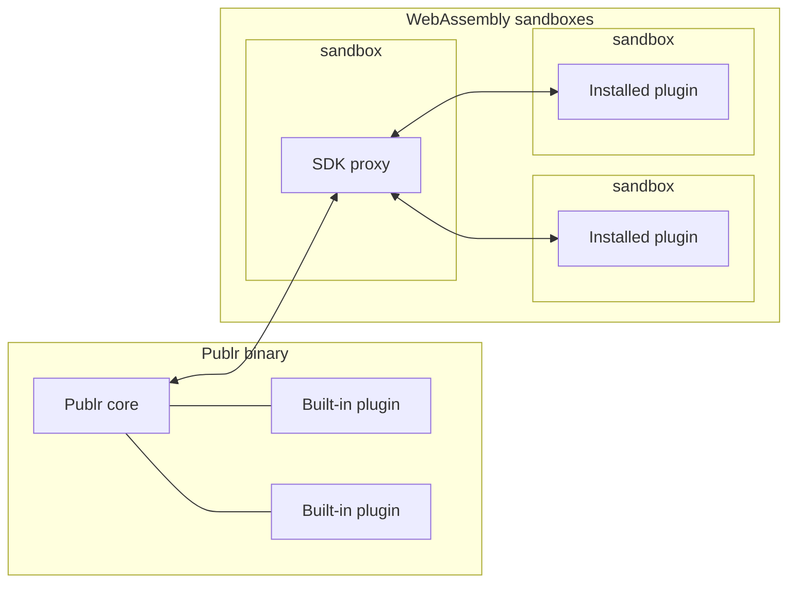
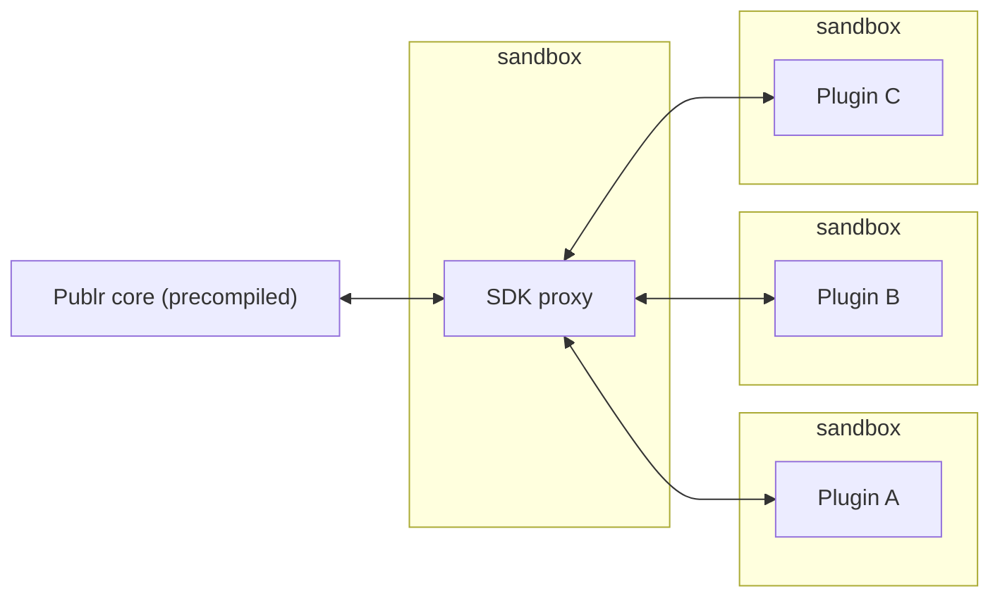

# Plugins

Plugins and apps follow [How to build well](agents.md#how-to-build-well).
Every declaration and its shape is listed in the [Plugin API reference](plugin-api.md).

Publr has two ways to run a plugin. Both use the same SDK. The difference is
where the plugin lives and who decides that it is there: every plugin is either
**built-in** (compiled into the binary, locked: it cannot be disabled) or **installed**
(loaded at runtime into the sandbox: enabled, disabled and removed from the admin). The same
source builds either way. In the code a plugin's mode is `native` or `sandboxed`, and what
its operations and hooks take (`*publr.Ctx`) makes direct calls for a native one and sends
every call to the host as a message for a sandboxed one.



## Built-in plugins

A built-in plugin is placed into the Publr binary by a developer or a
build tool. The result is a tailored Publr: one binary with every battery
someone decided to put inside.

From the user's point of view these plugins are core features. They cannot
be disabled, removed or updated from the admin. Updating one means updating
the plugin source and building a new binary.

This is sometimes called **agency mode**: a software agency prepares the
build for a client, so what the client gets is stable, has every feature they
need, and just works. Only a competent operator decides what goes in, which
makes this setup very safe and resilient.

Two things follow from being inside the binary:

- **Full access.** A built-in plugin can reach the whole Publr API and any
  internals. Whoever builds the binary is responsible for checking it.
- **Deep integrations are possible.** Some plugins must be compiled in because
  they need things the SDK does not expose to the outside: swapping the
  database, adding database extensions, replacing the cache layer, and other
  advanced hooks.

A plugin that uses only the public SDK can be shipped both ways: compiled in,
or as an installed plugin. Whatever it does installed, it does the same compiled in, and
`zig build verify-full` proves it for every test plugin (see
[Build: Two-mode check](build.md#two-mode-check)).

## Installed plugins (DLP)

Installed plugins are the opposite. They are added from the admin, without
recompiling anything. Think of them as dynamically linked plugins, in the
spirit of DLLs, hence DLP.



Each installed plugin is a precompiled WebAssembly module running in its own
sandbox. It never touches Publr directly: every call goes through the SDK
proxy, which dispatches through the same operation pipeline everything else uses. That gives:

- **An enforced boundary.** The plugin can only do what the SDK exposes and
  what an administrator granted it.
- **Isolation.** A buggy plugin cannot crash Publr or read another plugin's
  memory. A call that loops or grows past its limits stops, and only that call fails.
- **No recompilation.** Install, update or remove a plugin from the admin or
  the CLI, and it just works. Publr stays one binary.

Installed plugins are managed under Settings > Plugins in the admin, and with `publr plugin`
([CLI](cli/plugin.md)). The Built-in tab lists the built-in plugins beside them. Each has
the same page as an installed one, read only: what it asks for (all granted), its data, its
log. A build puts those there, and only a new build changes them, so nothing on it enables,
grants, updates or removes. Added, an installed plugin
is listed and runs nothing; **enabling** it shows what it asks
for and starts it; disabling stops it and keeps what it was granted. What it does, it
does as itself: every call it makes is authorized as the plugin, with the permissions it
holds now. When it acts for someone (an editor calling its operation, a hook on their
save), each call gets the narrower of its permissions and that person's roles.

A newer module for a plugin already there does not replace it: it waits as the
plugin's next version. **Updating** shows what the new version asks for beside what the
plugin holds, then runs it; the version it replaces is kept, and **rolling back** returns
to it (and keeps the other in turn). A module that does not load in the sandbox is never
added.

### Permissions

A plugin asks for permissions in `define`'s `.permissions`: a key, what it narrows to,
yes/no flags, and a reason. They are requests: the administrator sees the sentence, the
reason, the types it names, the key, a switch for the key and one per flag, and a tier
that follows the flags left on, before enabling the plugin. The plugin runs with what it
got, and `ctx.grant("records.write")` tells it whether the key is on and with which flags.

```zig
.permissions = &.{
    .{
        .key = "records.write",
        .records = &.{"products.variant"},
        .publish = true,
        .reason = "Puts the supplier's new prices live",
    },
    .{
        .key = "http.fetch",
        .domains = &.{"api.supplier.com"},
        .reason = "Downloads the supplier's price list",
    },
},
```

| Key | Narrowed by | Flags | Tier |
|---|---|---|---|
| `records.read` | `.records` | `.drafts`, `.private`, `.internal` | low; medium with drafts, high with private or internal |
| `records.write` | `.records` | `.publish` | medium; high naming no type |
| `records.destroy` | `.records` | | high |
| `project.put` | | | high |
| `terms.read` | `.taxonomies` | `.drafts`, `.private`, `.internal` | low, rising as `records.read` |
| `terms.write` | `.taxonomies` | `.publish` | medium |
| `schema.read`, `schema.write` | | | low, high |
| `users.names`, `users.read`, `users.write` | | | low, high, high |
| `site.read` | | | low |
| `settings.write` | | | high |
| `http.fetch` | `.domains` | | high |
| `media.read` | | `.private` | low; high with private files |
| `media.write` | | | medium |
| `email.send` | | | medium |

What each opens:

- `records.read` starts at what an anonymous visitor sees: published records of public
  types. `.drafts` opens drafts, pending changes and version history; `.private` content
  types marked Private; `.internal` other plugins' internal records. Naming types in
  `.records` covers those types whatever their kind; `.drafts` applies either way. A list
  or a query spanning several types answers each by its own grant: drafts of the types the
  plugin reads drafts of (or writes), live records only of the rest.
- `terms.read` does the same for terms: live terms of public taxonomies; `.drafts` draft
  terms, `.private` taxonomies not marked Public; naming them in `.taxonomies` covers
  them whatever their kind. `.internal` is for internal taxonomies, which core does not
  have yet. `terms.write` reads the taxonomies it writes, draft terms included.
- `records.write` reads the types it writes, drafts included. Without `.publish`, creating
  starts a record in its first status, changes to a published record wait as pending
  changes, and a transition into or out of a published status answers `.pending` for
  someone who may publish to approve; with it, they go live. Private and internal types
  only when named. `records.destroy` alone removes a record for good.
- `project.put` is for plugins keeping copies of a project in step (rollbacks, merges):
  `project.put` puts anything it stores (records, internal records, terms, content types,
  taxonomies, field groups, roles, users, installed plugins' rows) exactly as another copy
  keeps it, ids and history kept; records and terms land as the same change made by a
  person would. Rows only, never files.
- Queued work (jobs, `on` hooks) runs with the plugin's own grant, `.publish` included.

A `call:<plugin>.<verb>` key, for another plugin's operation, and `ai.progress` pass as
they are. Any other key, or an option its key does not take (`.domains` on
`records.read`), fails the build. They are requests: the administrator sees each with its
flags as switches, may switch a flag or the key off before enabling and at any time after,
and `ctx.grant(key)` says whether the key is on and with which flags. A switched-off flag
shows in answers (`.pending`, `Denied`, a query finding nothing), never as a crash.

Some operations no permission names, so no plugin ever reaches them: signing in and out,
passwords and set-password links, who may sign people in, setup, roles, saved views, the
project's secrets, a person's conversations with a model. A
plugin always reaches its own operations (`<name>.*`, `app.<name>.*`), its own content
types' records, its taxonomies, settings and internal records without asking. A compiled-in
plugin is granted what it asks for, as asked; its code's calls are held to it whoever it
runs for, the same as an installed plugin's.

Any key or flag can be switched off at any time; the plugin's next call answers `Denied`,
`.pending` or finds nothing, and it must carry on without. A key nothing installed provides is shown
as unavailable: the plugin runs without it.

### Calling out, and secrets

A plugin granted `http.fetch` sends requests with `ctx.call(publr.operations.http.Fetch,
...)`: to the domains its request names in `.domains` (exact, `*.example.com`, or `*` for
any public address), over https, or in development plain http to this machine when listed;
in production never a local or private address or the server itself (by name or by
address), compiled in or installed. `ctx.grant("http.fetch").domains` is the list as
granted now; an update's new domains join it when the administrator allows the update. A key it needs is a **secret it names but never holds**: it
declares its secrets as a struct, each field one secret, its `///` what it is and where to
find it, and writes `{secret:NAME}` where the value goes, in the address, a header or the
body:

```zig
/// Secrets this plugin uses; an administrator fills them in.
const Secrets = struct {
    /// Supplier API key
    ///
    /// In the supplier's dashboard under Settings › API › Keys.
    SUPPLIER_API_KEY: publr.Secret,
};

// in define: .secrets = Secrets,
```
Declaring is the request: a secret is not a permission. The plugin uses exactly what it
declares; a `{secret:NAME}` its code writes without declaring it fails the build, and one
made at run time is refused (`SecretNotDeclared`). A plugin with secrets asks for
`http.fetch`, the only way one is sent. At install each secret's field sits under the
`http.fetch` request with its label and where to find it: optional, filled later on the
plugin's page, which says what is still missing; once set it shows "Set" (or "Set, shared
with" the other plugins naming it) and Replace, never the value. Names are site-wide:
plugins naming `OPENAI_API_KEY` share one value. The value is filled in as the request
leaves, and put back as `{secret:NAME}` wherever the answer echoes it. It comes from the
environment variable of the same name, else from what an administrator set (on the
plugin's page or under Settings › Secrets, [`secret`](cli/secret.md)). With no value the
request is refused in words: "Supplier API key isn't set" (`SecretMissing`).

### Model providers

A plugin becomes a model provider by registering two operations, built by `publr.ai`:
`publr.ai.Describe("<name>", .{...})` (its label, models, default model, and its key: the
secret it is kept under, where it is made, what to do there, how it starts) and
`publr.ai.Complete("<name>", complete)`, where `complete` turns a `publr.ai.Request` into a
`publr.ai.Response` by calling its API through `http.fetch`. Core finds every provider
installed by those names, lists them under Settings › AI, and has a conversation's agent
call the one chosen, in the agent's own process. Publr's official providers are published at
`https://plugins.publr.app` (a `catalog.json` and the built modules it lists;
`PUBLR_PLUGIN_CATALOG` names another folder or address). The Overview and Settings › AI
install the ones ticked: each module is added, as uploading it does, enabled, and granted
its requests out, its key and its raised limits, so the key pasted next is all it needs.

A message's parts are text, tool calls, tool results and images (a media type and base64
bytes: screenshots the agent takes, pictures the person attaches); in a tool message the
images follow the results. A provider sends each in its API's own shape. Pictures make a
request a few MiB, so providers ask for more memory than the default (`limits`), and
`http.fetch` sends up to 8 MiB. A provider that streams reads the reply with `http.stream`
and `http.read` and passes the words on with `publr.ai.Progress` (`ai.progress`, a
permission of its own) as they come; `publr.ai.Events` splits the stream into its
`data:` lines.

A provider that turns speech into text says `.speech = true` in its description and adds
`publr.ai.Transcribe("<name>", transcribe)`: a recording (`publr.ai.Speech`: base64 audio,
up to 768 KiB, and its media type, `audio/webm`, `audio/ogg`, `audio/mp4`, `audio/wav` or
`audio/mpeg`) in, its words out. Core's [`ai transcribe`](cli/ai.md) calls it. A file goes
to an API as a form upload: `http.fetch`'s `form`, whose file parts are base64, is written
as `multipart/form-data` by core, so a plugin never encodes one.

### Limits

Every call into a plugin runs within limits: 100 ms of CPU (counted in instructions),
16 MiB of memory, 1,000 calls of its own, 1 MiB of output. A plugin that needs more asks
in `define`'s `.limits`, with a reason; each raised limit is a high-tier request.

## Writing a plugin

A plugin is a folder with a `main.zig`. Installed or built-in, it is written the same way,
against the same SDK. Its words are its doc comments, and one registration, last in
`main.zig`, says what it brings:

```zig
//! Entries people add and remove, on a page of its own.
//!
//! List the entries with `notes list`, add one with `notes add`. The page in the admin
//! shows them all.
const std = @import("std");
const publr = @import("publr");

const manifest: publr.Manifest = .{
    .name = "notes",
    .version = "0.1.0",
};

// ... records, operations, hooks ...

pub const plugin = publr.plugin.define(manifest, .{
    .records = &.{Entries},
    .operations = &.{ List, Add },
});
```

- **The words.** The first line of `main.zig`'s `//!` is the plugin's description; the
  rest is the text on its settings page. An operation's words are the `///` above it, or
  its file's `//!`. Every field of a record, an input and an output has a `///`. A
  missing comment fails the build, and says where it goes. `publr plugin build` and
  Publr's own `zig build` read them from the source.
- **The options** are struct fields: a misspelt one fails the build. Every part is written
  out where it is used (`.records = &.{Entries}`, `.operations = &.{List}`); Publr never
  looks inside a file for a name.
- **Decided but not built.** `define` refuses these options and names the gate that brings
  them: `register_taxonomies`, `register_columns`,
  `register_components`, `register_providers`, `register_location_rules`, `taxonomies`,
  `jobs`, `webhooks`. Queued work, schedules, email, outside search engines and field
  editors in the plugin frame come with later gates too.

### Operations

```zig
pub const AddIn = struct {
    /// The entry's title, 1 to 160 characters
    title: []const u8,
};

pub const AddOut = struct {
    /// The new entry's id
    id: []const u8,
};

/// Adds an entry.
///
/// Administrators, and callers granted `notes.add`.
///
/// Fails:
/// - Full (409): the plugin keeps at most 1,000 entries
///
/// Example:
///   in: { "title": "First" }
///   out: { "id": "0a1b2c3d4e5f60718293a4b5" }
pub const Add = publr.operation.define(AddIn, AddOut, .{
    .name = "add",
    .kind = .write,
    .validate = check_add,
    .run = add,
});

fn check_add(in: AddIn, problems: *publr.Problems(AddIn)) void {
    if (in.title.len == 0 or in.title.len > 160) {
        problems.add(.title, "A title is 1 to 160 characters");
    }
}

fn add(ctx: *publr.Ctx, in: AddIn) publr.Error!AddOut {
    return .{ .id = try Entries.create(ctx, .{ .title = in.title }) };
}
```

- `.name` is the verb; the operation is `<plugin>.<verb>` (`notes.add`). `.kind` is `.read`
  or `.write`; a write runs in a transaction.
- The words: the first line is the description, then the details, then `Fails:` (each
  `- Name (status): what it means`; the status is 409 when left out, any 4xx but 401 and
  429), then `Example:` with an `in:` and an `out:` line of JSON. The example is read into
  the operation's types when it compiles and is what `--help` shows.
- `.authorize` says who may call. Left out: administrators, and roles an administrator
  granted the operation; with `.untrusted_callers = true`, anyone. A ready answer is data
  a site can read: `publr.authorize.user_is_signed_in` (needs `.untrusted_callers`),
  `user_has_role(&.{"editor"})`, `plugin_calls`; the host checks it before anything runs.
  Or a function of the plugin's own, `fn (ctx: *publr.Ctx, in: In) bool`, run first in
  the call. Administrators pass every ready answer, except through an app's address.
- `.untrusted_callers = true` lets anyone call it without credentials: a site's pages,
  and any script anywhere. Treat its input as untrusted, key data to the caller, answer
  with nothing of other people's. `.public_api = true` lists it in the published API
  reference and changes nothing about who may call.
- `.validate` reports every problem at once with `problems.add(.field, "reason")`; the call
  is refused as `Invalid` (422) with a `problems` list, each beside its field. Records check their own data; `.validate` is only for
  what belongs to the call.
- `.destructive = true` says it erases for good.

A site's pages call an operation at `<mount>/_actions/app.<plugin>.<verb>`: forms, islands
(JSON with `Publr-Request: 1`), and `Publr.request.call('app.<plugin>.<verb>')` in a page's
frontmatter. Through that address an administrator is a signed-in person like any other,
and an operation without `.authorize` is never reached.

### The context

`run` takes `ctx: *publr.Ctx`:

| Call | What it does |
|---|---|
| `ctx.call(Operation, in)` | any operation, through the same checks as every caller; its own definitions too (`ctx.call(Add, ...)`) |
| `ctx.fail(.Name, "Only {left} left", .{ .left = left })` | refuses in the plugin's words, translated, with the status its `Fails:` line gives; the write rolls back |
| `ctx.t(text, values)`, `ctx.tn(one, many, count, values)` | text for people in the caller's language |
| `ctx.log(.info, "Charged {s}", .{amount})` | a log line with a level (`.info`, `.warn`, `.err`): under the call in the Activity log or Error log, and on the plugin's Log tab |
| `ctx.now()` | the call's time as `publr.Time`, the type of `datetime` fields |
| `ctx.caller()` | who calls: `.from`, `.visitor`, `.referer`, `signed_in()`, `has_role(name)`, `granted()`, `is(id)` |
| `ctx.grant(key)` | whether a permission is on, its flags, and (`http.fetch`) its domains |
| `ctx.emit(Event, payload)` | emits an event: `after` hooks now, `on` hooks from the queue once the write commits |
| `ctx.arena()`, `ctx.alloc(T, n)`, `ctx.print(fmt, args)` | memory freed when the call ends |

### Records

```zig
/// Post
///
/// An article: its own page under /posts, listed newest first.
pub const Post = struct {
    /// Title
    title: []const u8,
    /// Slug
    slug: ?[]const u8 = null,
    /// Body
    body: ?[]const u8 = null,
};

pub const Posts = publr.record.define(Post, .{
    .name = "blog.post",
    .public = true,
    .url = "posts",
    .fields = .{
        .slug = .{ .kind = "slug", .options = .{ .source = "title" } },
        .body = .{ .kind = "richtext", .searchable = true },
    },
});
```

The struct is the record: its `///` is the type's name and description, each field's its
label and help. Kinds follow the Zig types (text, integer, number, boolean, `publr.Time` a
datetime, an enum a select, a `Posts.Ref` or `publr.record.AnyRef` a reference); a field
without a default is required. `.fields` overrides a field's kind, its rules
(`.validation = .{ .max_len = 280 }`, checked on every write whoever writes, and shown
beside the field's help) and its options (how it is edited). `.internal
= true` makes it the plugin's bookkeeping (internal records, never in the admin's content
list), with `.indexed` for the fields it is found by (`&.{.page}`). The name is the plugin's
and the type's, `blog.post`: apps, GROQ, `--type` and other plugins use it whole. A
`.validate = fn (Post, *publr.Problems(Post)) void` checks rules across fields on every
create and save, whoever writes. Other options: `.title_field` (a field, `.title`),
`.public`, `.url`, `.plural_name`, `.menu`, `.editor`, `.kind`, `.app`. The handle reads and
writes typed values: `Posts.get(ctx, id, .{})`, `Posts.find_one(ctx, .slug, "hello")`,
`Posts.create(ctx, value)`, `Posts.save(ctx, id, fields, .{})`.

A record declares its statuses and the transitions between them:

```zig
pub const GreetingStatus = enum {
    /// Draft
    draft,
    /// Shown
    published,
};

const greeting_flow = [_]publr.record.Transition(GreetingStatus){
    .{
        .name = .publish,
        .from = &.{.draft},
        .to = .published,
        .label = "Show",
        .authorize = publr.authorize.user_has_role(&.{"editor"}),
    },
};

pub const Greetings = publr.record.define(Greeting, .{
    .name = "hello.greeting",
    .status = .{
        .list = GreetingStatus,
        .start = .draft,
        .flow = &greeting_flow,
        .published = &.{.published},
    },
});

// a record changes status only by a named transition:
const held = try Greetings.get(ctx, id, .{});

if (held.status == .draft) {
    _ = try Greetings.transition(ctx, held, .publish);
}
```

`create` starts a record at `.start`, which is required. A transition names the statuses it
leaves (`.from`, or `publr.record.any`), the one it reaches, and may say who makes it
(`.authorize`, refused to anyone else on every path that moves a record). Every flow also
has core's `trash` and `restore`. Core's `draft`, `published` and `archived` keep their
meaning; a record's own statuses are stored under its plugin's name (`hello.in_review`).

Anything more than one record by id or one field is a GROQ query, never a query language
of Publr's own:

```zig
const greetings_so_far = publr.query.prepare(
    \\count(*[_type == "hello.greeting"])
, .{});

const rows = try greetings_so_far.execute(ctx, u32, .{});
```

A query's `$names` are bound from the struct `execute` is given and never written into the
text; a `$name` the struct lacks, or a field the query never names, fails the build. It
reads as the caller, with their access applied, and leaves trashed records out.

### Hooks, events and other plugins

```zig
/// A greeting was recorded.
pub const Recorded = publr.event.define(.{
    .name = "recorded",
    .payload = struct {
        /// The greeting text
        note: []const u8,
    },
});

fn announce(ctx: *publr.Ctx, in: *RecordIn, out: *const RecordOut) publr.Error!void {
    ctx.emit(Recorded, .{ .note = in.note });
}

/// Thanks whoever wrote it, once the greeting is kept
fn thank(ctx: *publr.QueueCtx, recorded: Recorded.Payload) publr.Error!void { ... }

// in define:
.hooks = &.{
    publr.after(Record, announce),
    publr.on(Recorded, thank),
},
.events = &.{Recorded},
```

A hook names what it hooks by type: an operation of the plugin's own, one of
`publr.operations`, a remote, or an event, and a named function. `before` (operations only)
sees and may change the input, `after` sees the answer or the payload inside the write and
may refuse, `on` hears it from the queue once the write committed: an operation's answer as
it was, or the event's payload. Every operation emits its own event on success; a plugin's
event is for something that happens that is not a call; its payload is typed, and it is
named `<plugin>.<name>`. An `on` hook can't refuse: one that fails runs again on its own, as
a failed job does (a minute later, doubling, eight runs in all), and after the last it shows
failed on the plugin's Log and in `publr job list`; the record and the person's values stay.

A plugin never imports another. It describes another plugin's things with only what it
uses, checked against the real ones: `publr.remote.operation("newsletter.subscribe", In,
Out)`, `publr.remote.record("products.variant", Fields)` (a typed handle on another
plugin's records, still needing a `records.*` permission), `publr.remote.event(name,
Payload)`. The plugins it needs go in `.depends_on` (`"newsletter@^1.2"`), the ones it uses
when present in `.compatible_with`.

### Field kinds and fields on other records

```zig
/// Location
///
/// A point on a map, with its address.
pub const Location = struct {
    lat: f64,
    lng: f64,
    address: []const u8,
};

// in define:
.field_kinds = &.{publr.field.kind(Location, .{ .name = "location", .validate = check })},
```

The kind is named under the plugin (`places.location`); its storage follows the value (a
struct is kept as JSON), its words are the `///` on the value, and `.validate` runs on
every write. Until editors reach the plugin frame, the form shows such a value as JSON.

`.register_fields` puts a group of fields on users, media or any type, placed with core's
location rules:

```zig
.register_fields = &.{.{
    .fields = Points,
    .location = &.{.{ .rules = &.{.{ .field = "destination", .value = "user" }} }},
}},
```

### Checks

`publr plugin check --dir <folder>` reads a plugin's source for what the rules forbid and
the compiler cannot see: money kept as a plain number (`total: u64`), a time as a number
(`created_at: i64`), a reference as text (`product_id: []const u8`), JSON in text
(`extras_json`), an untrusted write taking facts the server owns (a price, a total), an
import reaching outside the plugin's folder. A `Why:` line in the field's `///` passes a
name check and shows to whoever reviews the plugin. `plugin build` and Publr's `zig build`
run the same checks on every plugin registered through `define`, and fail on what they
find.

### What an installed plugin asks for

On top, an installed plugin says what it needs, in `define`:

```zig
.permissions = &.{.{ .key = "users.names", .reason = "Greets the people on the site by name" }},
.limits = .{ .cpu_ms = 2000, .reason = "Resizes images" },
.depends_on = &.{"newsletter@^1"},
```

A plugin never writes `export fn`.

### Panels on edit forms

A plugin can add a box to any content type's edit form, its own type, another plugin's,
or the core's, without that type's plugin knowing about it:

```zig
// in define:
.panels = &.{.{ .type = "product", .label = "Stock", .operation = StockPanel }},
```

`StockPanel` is one of the plugin's reads, taking `record` (the record's id) and `base`,
answering `html` drawn by its own view: `publr.views.render(ctx, in.base,
publr.views.all.StockPanel, props)`, a `ui/StockPanel.ptsx` on the `PanelPage` layout,
which draws what the panel shows and nothing around it. The admin shows it in the editor's right column, titled with its label
and the plugin's name, in the plugin frame sized to its content; `call` and `query` work
in it as on the plugin's pages. It is told only which record it is on and reads the rest
itself, within what it and the viewer may. It shows to whoever may call the read, on
records of that type, and not at all when the type is not there.

### Menu items, the top bar, and what a plugin says about itself

The admin's menu is built from menu items. A plugin declares its own, and its records (and
other plugins' records and items) sit under them by naming them; the item's plugin never
knows who sits under it. An item whose parents do not exist is a part of the admin of its
own: listed in Content, pinnable to the rail by each person, its children headings in its
sidebar:

```zig
const shop_menu: publr.MenuItem = .{ .name = "shop", .label = publr.t("Shop"), .icon = "products.bag" };
const store_menu: publr.MenuItem = .{
    .name = "store", .label = publr.t("Store"), .icon = "tag", .parent = &.{"products.shop"},
};

// in define:
.menu = &.{ shop_menu, store_menu },

// on a record: the first of these that exists, else where content types go
.menu = .{ .parent = &.{ "products.store", "checkout.orders" } },
```

An item opens one of the plugin's record types' lists (`.record`), one of its pages
(`.page`), or nothing (a heading). The rail is the person's: no plugin adds to it, though an
administrator may pin a page for everyone. A list starts where its type's `.data_view`
says (columns, filters, order); people change it from the view knob, the column headers and
Filter, and keep it as their default or a view. Which fields filter and sort is the fields'
own (`filterable`, `sortable`). A plugin may bring
icons of its own (`.icons`), each drawing sanitized before a page shows it.

A page that says `.top_bar = .{ .count = Count }` is also in the top bar, drawn by the
admin's own components so it looks like its own and passes for nothing else, with the
count a read answers beside its label.

What the plugin says about itself on its page under Settings › Plugins is its `main.zig`'s
`//!` past the first line, through the admin's sanitizer profile, in a box the admin draws
and names after the plugin.

### Pages in the plugin frame

Any plugin, installed or built-in, can bring pages of its own, listed in the Settings
sidebar for whoever may call the read that draws them:

```zig
const log: publr.plugin.Page = .{
    .path = "log",
    .label = "Guestbook log",
    .icon = "stack",
    .operation = Page, // a read: In has `query` and `base`, Out has `html`, all strings
};

// in define:
.pages = &.{log},
```

The page is at `/admin/plugin/<plugin>/<path>`. The admin draws its chrome and puts the
plugin frame in the sheet: an `<iframe sandbox>` with an opaque origin. The frame's
document is the `html` the read answers, run as the person looking at it, with the
address's query string as `query` and the path the project is served under as `base`.

A compiled-in plugin draws the page with the admin's own layouts, so it looks like any
other Settings page: its view (an `IndexPage`, a `FormPage`) rendered whole with
`publr.admin.render.document(arena, publr.admin.chrome.in_plugin_frame(ctx, in.base),
View, props)`, which leaves out the rail, the sidebar and the crumbs the admin already
draws around the frame, and speaks the person's language: `Publr.t` in the view reads
their catalogue. An installed plugin gets the same once the design system is drawn
for it by the host; until then it answers its own markup. It gets the admin's stylesheet and a small bridge, and
nothing else: no session, no network (`connect-src 'none'`), and it can be framed only
by the admin. Its response carries the same policy, so it stays sandboxed even when
opened on its own.

Inside, anything goes: any markup, any script, any library. The admin's design system
is the easy default. The frame reaches the admin only through the bridge:

- `publr.call("guestbook.sign", input)` runs one of the plugin's own operations as the
  viewer, through the usual checks, and resolves with its output. Anything else is
  refused.
- `publr.navigate("log?week=2")`, and every link clicked, goes to another of the
  plugin's pages (`?week=2` alone stays on this one). A link to another site opens in a
  new tab.
- The frame grows with what it shows.

What the frame draws never reaches the admin, so it needs no sanitizing and no
permission.

A page can also be a declaration, with no views of the plugin's: `.form = .{ .read =
Read, .save = Save, .multiline = &.{"description"} }` instead of `.operation`. The admin
draws it as one of its own pages (no frame: nothing of the plugin's is drawn), a field for
each field of `Save`'s input (strings, numbers, switches; `multiline` ones as several
lines; each field's `///` as its help), filled from what `Read` answers; Save calls
`Save` as the person looking. It works the same for an installed plugin, which draws
nothing else in the admin yet.

In a page's PTSX, `publr/operations` does the talking, the same in the frame and on an
admin page: `call("guestbook.sign")` is a write through one of the plugin's operations
(called with its input; `isPending`, `error`, `value`), after which every read on the page
reads again; `query("guestbook.entries")` is a reactive read (`value`, `isPending`,
`refresh()`), and ``query(groq`*[_type == "entry"]`, () => params)`` a GROQ read through
`record.query`, run as the plugin for the viewer, so it reads no more than both may. The
admin's composites (`FieldRow`, `ItemList`, `StatusStrip`) and `OperationForm` (a form
from a list of fields and the operation that saves them) make the page look like the
admin's own without styling it. `publr plugin build` writes `ui/operations.d.ts`, each
operation's input and output as TypeScript, and `plugin scaffold` gives a working plugin
to start from.

## One folder, and which are compiled in

Every plugin of a project is a folder under `plugins/`, `plugins/<name>/main.zig`, the
same source whichever way it runs. Which are compiled in is the project's decision, in
`publr.zon` beside that folder, and nothing else's:

```zig
.{
    .plugins = .{
        .native = .{ "blog", "hello" },   // compiled into publr: Built-in in the admin
    },
}
```

or every plugin under `plugins/`:

```zig
.{
    .plugins = .{
        .native = .all,
    },
}
```

With no `publr.zon`, or no `.plugins.native`, none is: every plugin is built for the sandbox and
installed at runtime. A plugin never says which it is: trusting code with everything is
its owner's choice, never its author's. `zig build` compiles in the ones listed (a name
`plugins/` lacks fails the build).

`publr plugin build --name <name>` builds `plugins/<name>/main.zig` for the sandbox with the
compiler Publr carries, so no Zig is needed: its manifest is read from the module itself and written into it, then it is added
and enabled (a new plugin) or applied as its next version (one already there, the previous
kept to roll back to). What it asks for is granted by tier; high requests wait for an
administrator. Built again unchanged, it is up to date. `zig build sandboxed-plugins` builds
every plugin under `plugins/` that is not compiled in with the same command into
`zig-out/sandboxed-plugins/<name>.wasm`, as the tests build theirs; see
[Build](build.md#the-plugins).

**Every plugin builds for the sandbox.** What cannot run there is left out of that build,
never a reason to refuse it: `schema_sql`, `bootstrap` and a sign-in provider (they need
the host), an operation or hook that takes the host's context (`*sdk.Ctx`) rather than
`*publr.Ctx`, and, until the sandbox runs them, policies, pre hooks, field kinds,
statuses, transitions, filters, delivery gates, routes, settings pages, `State`, operator
commands and the other process hooks. The build names each (`publr plugin
build` prints them; the manifest's `left_out` keeps them, and `plugin get` shows them;
the admin's plugin page does not yet).
Calling an operation left out answers `unavailable`; a hook left out never runs.

What a plugin calls is checked as it compiles: a `ctx.call` of an operation that none of
its declared permissions opens fails the build, naming the permission to add ("plugin
peek calls `user.list`, which needs `users.read`"). Its own namespace, the harmless
operations and record operations pass: a record operation may reach its own types, which
need nothing, and one that names another type without a permission is refused when it
runs, as `Denied`.

In the sandbox, operations, before, after and on hooks, filters, records, field groups and
roles run, and pages, menu items, panels and top bar entries show in the admin; a role from
a plugin grants only its own operations.

## Which one to pick

| | Built-in | Installed (DLP) |
|---|---|---|
| Added by | developer or build tool | admin, marketplace, repository |
| Needs a rebuild | yes | no |
| Access | full, trusted | SDK only, within its permissions |
| Isolation | none, it is part of the binary | sandboxed |
| Can be disabled or removed by the user | no | yes |
| Deep integrations (database, cache, ...) | yes | no |
| HTTP routes of its own | yes | not yet |
| Admin pages, panels and a top bar item | yes | yes, in the plugin frame |
| State, process hooks, operator commands | yes | not yet |
| Uses only the public SDK | works | works |

## Writing a built-in plugin

A built-in plugin is written as above and listed in `publr.zon`'s `.plugins.native`. It
imports one thing, `publr`, and everything it brings goes in `define`: records,
operations, hooks, events, roles (see below), policies, delivery gates (who sees the
apps, see [Apps](apps.md#delivery-gates)), filters (`model.filter.Definition`: a key, a
label, operators, and how a clause constrains the list; the admin's content list grows a
pill for each) and a sign-in provider (see below). `zig build` finds it, compiles it in and
wires it up; nothing is registered anywhere else. Its operations appear in the CLI and
every other adapter, documented from its words. A plugin cannot take a core namespace's
name, or `app`. The options described below that only a built-in plugin may use (routes,
state, process hooks, settings pages and tabs, `schema_sql`, migrations, the app picker
segment) keep their names inside `define`.

Storage is records and snapshots. A plugin that needs to keep things declares a record
(`publr.record.define`, usually private) and works with it through its handle. The type is
created, or brought up to date, when the database opens, owned by the plugin:
it shows in the types manager as a system type, its declared fields are
locked, and editors can add fields of their own that survive the next
redeclaration. Its records get validation, permissions, listing, filtering
and the admin for free. History goes into
snapshots (`snapshot take/list/prune`, kinds of the plugin's own); parked
copies of a document go into slots (`record get --slot`), like the core's
`pending`. A plugin that truly needs its own table ships `schema_sql`; it runs only when
the plugin is compiled in. Once a release of the plugin has shipped, a change to those
tables is a migration of its own, the `.migrations` option (`publr.db.migration.Migration`s),
named by the release that ships it and run by the gate like core's ([Updates](updates.md)).

A plugin that keeps files declares a **media type**: a type of `.kind = .media` with a
`title` field and, optionally, the file families it takes (`.families = &.{"image"}`).
Its files are uploaded with `media upload --type <handle>` (`/media/upload?type=`),
listed with `media list --type`, read with `media read`, and kept apart from the media
library and every other type: they show nowhere until the plugin draws them on a page of
its own. A Private media type's files are private. Sandboxed plugins declare one the same
way.

A page shows its type's files with the admin's own library: `<MediaLibrary type="invoice_file" />`
(`@publr/admin/MediaLibrary.ptsx`) is the whole of Media's screen for that type, the bar,
the explorer, the tiles and a file opened in place, reading the files of the address it
is on. Its parts lay it out differently or beside a page's own:
`MediaLibraryFilterBar` (with `MediaLibraryUpload`, or other actions, as children),
`MediaLibrarySidebar`, `MediaLibraryGrid`, `MediaLibrarySelection`, `MediaLibraryPager` and
`MediaLibraryFile`, inside `<MediaLibrary type="…">`. A part of the page's own imports
`state` and the actions (`follow`, `load`, `toggled`…) from `MediaLibrary.ptsx`, so its
table filters, pages and selects as the grid does. On a Settings page, `<ListDetailPage sidebar>` keeps the
Settings sidebar beside it. On a compiled-in plugin's own route it
works today; in the plugin frame it waits on the frame reaching `media` operations.

A plugin can declare roles (`.roles`, each a `publr.plugin.Role`): a name, a
label and grants, each an operation or a namespace ending in `.*`. A name of its own is
a new role, such as the visitors of an app, granted `<feature>.*`; the name of one
there already adds grants to it, so a plugin whose operations editors should call
declares `editor` with `<feature>.*`. The roles are made the first time the plugin
declares them; after that an update adds only the grants new in it, so what the site
changed stays. Only an admin gives an account a role; a plugin's open sign-up creates
accounts with its own. See [Auth](auth.md#roles).

A plugin can declare one **sign-in provider** (`.sign_in_provider`, a
`publr.plugin.SignInProvider`): a name (`github`, in URLs and identity rows), a label
("Continue with GitHub"), its mark as one SVG path on a 24 by 24 canvas (brand marks are
the plugin's, never the icon set's), and three functions: `available`, whether its client
id is in the environment (an unavailable provider is compiled in but not offered, as is one
whose declared secrets are not all set); `authorize_url`, where to send the browser given
the callback URL, the `state` and the PKCE challenge the core made; and `exchange`, which
swaps the callback's code for `Claims`: the provider's name, the person's stable id there
(`subject`), their email and whether the provider vouches for it, a name, an avatar. The
exchange is the one step of a sign-in that waits on another server, so it is a step of the
provider, never a hook: core runs it with a `publr.ExchangeCtx` that can only `fetch` (to
the plugin's own `http.fetch` domains, under the same rules as `ctx.fetch`, its client
secret written as `{secret:NAME}` and declared in `.secrets`) and `log`, for at most 10
seconds in all. No answer in time, or an error, and the login says "Try again"; the lines
go to the plugin's log under `sign_in:<provider>`. The core does the rest: the routes, the
cookie, the buttons, and whose account it is ([Auth](auth.md#signing-in-with-a-provider)).

A plugin can answer **HTTP routes** (`.routes`, each a `publr.plugin.Route`): a
method (`get` or `post`), a path and a handler, `fn (request, response, ctx)` like the
core's. Every path lives under a prefix the plugin owns, `/admin/<own>`, `/api/<own>` or
`/auth/<own>`, where `<own>` is its name or one of its namespaces; after the prefix a
segment may be a parameter (`/api/shop/orders/:id`). A plugin has at most 16. Its routes
come before the core's, and the server refuses to start when a prefix covers a core route
(a plugin named `content` would take `/admin/content`). A handler that calls operations
does it as whoever sent the request: `publr.plugin_routes.caller_context` gives the SDK
context, refusing a write that does not come from this site with the session's CSRF
token, as the REST API does. A route that signs someone in its own way (a token another
server made, say) gets a session from an operation and hands it to
`publr.plugin_routes.set_session`, which sets this site's session cookie as the core's
sign-in does. A `post` route may take `.stream` instead of `.handler` (a
`publr.plugin.route.Stream`: `open`, `write`, `finish`, `abort`): its body is handed over a
piece at a time as it arrives, up to the stream's own `bytes_max`, for an upload larger than
a request may be. Routes run only compiled in; an installed build leaves them
out and says so.

A plugin can show in the **admin**. Its views are PTSX files in `ui/` beside its
`main.zig`, lowered with the admin's own when it is compiled in: they import the design
system as `@publr/ui/<Name>.ptsx` and the admin's views as `@publr/admin/<Name>.ptsx`, and
are rendered as `publr.admin.views.<Name>`. A view's name may not be one the admin or the
design system has, so name it after the plugin. An icon it names only at runtime goes in
its `ui/icons.txt`, one per line, as the admin's do.

A plugin's page is drawn like the core's: its view returns one of the admin's layouts,
`IndexPage` (a list), `FormPage` (one thing), `HubPage`, `CardPage` or `ListDetailPage`
(working through a set of things one at a time, as a merge does), and fills its slots
(title, parents for the crumbs, description, actions, meta, tabs, notice, filters, the
list, empty, footer; for a form the column, the aside and the danger zone, where
`ConfirmAction` asks before anything is undone). Two versions of something compare on
`CompareSides` and `CompareField`, their values shaped by `publr.admin.compare` (see
`admin.md`). The layout draws the chrome, the
sidebar, the crumbs and every gutter; the view sets no spacing of its own, and the build
refuses a page drawn otherwise. Who is signed in and the CSRF token are read where they
are needed as `Publr.request.session` (`name`, `email`, `csrf`); no view forwards them.

```tsx
import { IndexPage } from "@publr/admin/IndexPage.ptsx";

export function GuestbookEntries({ entries }: GuestbookEntriesProps) {
  return (
    <IndexPage
      title="Guestbook"
      description="What visitors wrote, newest first."
      empty={entries.length === 0 && <Empty>…</Empty>}
    >
      <Table>…</Table>
    </IndexPage>
  );
}
```

The route's handler renders it with `publr.admin.screen(&session, .ok, View, props, .{})`,
the view's own data only, after `publr.admin.require` for the signed-in session.

- A settings page (`.settings_pages`, each a `publr.plugin.SettingsPage`): a
  label, an icon and the path of one of its own `get` routes, listed in the Settings
  sidebar for whoever may call the operation it names, and lit on that path and every
  path under it. A page that belongs under another's entry says so with
  `publr.admin.screen(&session, .ok, View, props, .{ .settings_path = "/admin/<other>" })`.
- A segment joined to the app picker (`.app_picker_segment`, a `fn (session: *const
  publr.admin.Session, attached: bool, apps: ?publr.admin.render.Node)
  publr.admin.Error!?publr.admin.render.Node`): drawn after the picker as one control where
  the project has apps (`attached` true: draw it as the control's end, `StatusButton
  attach="end"`), on its own in the top bar where it has none. Null shows nothing. On a
  phone the first segment drawn stands for the whole picker: it shows only its icon
  (`StatusButton compact`), and the drawer it opens lists `apps` first (on phones only),
  the apps the picker would have offered. Only that segment is given them.
- Where someone who must sign in goes (`.sign_in_at`, a `fn (session: *const
  publr.admin.Session) anyerror!?[]const u8`): asked on the login page before the form and
  before a trusted issuer; the first plugin that names an address sends the browser there.
  Null leaves the login as it is. The page they asked for is the login's `return`
  (`publr.admin.query_param(session, "return")`), a path on the site; carry it on with
  `publr.admin.query_value` so they land there once signed in.
- Actions on the rows of another plugin's page (`.row_actions`, each a
  `publr.plugin.RowAction`): the page's slot as its owner names it, a label, a path
  where `{name}` stands for the row's name, a row kind (every row when empty) and the
  operation whoever sees it may call. The page's owner reads them for each row with
  `publr.admin.row_actions(session, slot, kind, name)`; neither plugin knows the other's
  code. An installed plugin's actions count too, when they lead into the admin
  (`/admin/...`) through an operation of its own.

A plugin can **keep state** for as long as the process runs: one `.State` struct, made when the server opens the project (with `pub fn init(state: *State,
process: publr.plugin.Process) !void` when its fields need more than defaults; `deinit`
if it holds something to free) and never in a top-level `var`. An operation, a route or a
hook reaches it with `publr.plugin_states.of(ctx, @This())` from a context, or
`publr.plugin_states.from(project.plugin_states.?, @This())` from the project.

A plugin can also act on the process around the operations:

- `.before_command`, a `fn (command: *publr.plugin_hooks.Command) !void`, runs before any
  command, in name order: it may move the process into another folder
  (`std.process.setCurrentDir`) and take its own arguments off `command.args`, or change
  `command.db_path`. What is left runs as the command.
- `.serving`, a `fn (serve: publr.plugin_hooks.Serving) !void`, runs once `serve` listens, with
  the project and the port it got, before the first request. It may name the session
  cookie (`serve.project.session_cookie`), so two servers on one host keep their sign-ins
  apart. One that fails stops `serve`.
- `.operator_commands`, each a `publr.plugin.OperatorCommand`: a name and a
  handler, answered at `POST /_publr/<plugin>/<name>` only with the running server's
  operator key, which only processes of the same user on the machine can read
  (`<db>.serve`). `publr.operator.find` and `publr.operator.post` send one.

A plugin can **build on another**. It names what it depends on, each another plugin and,
after `@`, the versions it works with (exact, `1.2.3`, or caret, `^0.2`: the same leftmost
non-zero part, no older): `.depends_on = &.{"newsletter@^1.2"}`.
A compiled-in plugin's requirements are checked when the binary is built (present, in
range, never round a loop); an installed one's when it is enabled. A plugin it only works
with when present goes in `compatible_with`, with the same ranges.

A plugin never imports another. It declares, in its own words, each thing of another
plugin it uses, listed in `.remotes`: an operation (the name, what it sends and the part of
the answer it reads), a record type (only the fields it reads) or an event (its payload):

```zig
pub const Subscribe = publr.remote.operation(
    "newsletter.subscribe",
    struct { email: []const u8 },
    struct { subscribed: bool },
);
// in define: .remotes = &.{Subscribe},
// ctx.call(Subscribe, .{ .email = email }), or publr.after(Subscribe, run)
```

Every plugin's manifest carries the shapes of its own operations and events and the
remote ones it uses. When both plugins are compiled in, a remote that does not fit the real
one is a compile error naming the field if the plugin needs the other (`depends_on`); if it
only works with it, the build notes it and that remote is off. Otherwise it is checked when
the plugin is enabled
and whenever the other one changes: a required one that does not fit keeps the plugin
off, one it only works with is switched off on its own (its calls answer `Unavailable`,
its hooks don't run), and the plugin's page in the admin says which and why. A remote
record answers only the fields listed. A plugin's own `interface.zig`, beside its `main.zig`,
is for its own files: `@import("newsletter")` inside newsletter.

A write may also say what it does outside the database once it is kept:
`pub fn committed(ctx: *sdk.Ctx, in: In, out: Out) sdk.Error!void` runs after its
transaction commits, only when no other write encloses it (core's `design.save_system`
loads the apps this way). Its failure is the call's answer; the write stays.

A plugin can run once the database opens (`.bootstrap`, a `fn (ctx: *sdk.Ctx) sdk.Error!void`),
as the system, after every declared type and field is in place: a setting the product
needs, a record that must exist. It runs at every start, so it checks before it writes.

What a plugin keeps for itself and nobody edits (carts, reservations, stock movements,
logs) is not content: it declares each kind as a record with `.internal = true` (and
`.append_only = true` for a ledger written once and never changed), and reaches them through its handle or the `internal` operations (see
[the CLI page](cli/internal.md)): its own records only, in the request's app, with no
permission to ask for. They never appear in the admin's content list.

A plugin can also keep values on the accounts themselves: `.register_fields` declares
field groups, each with its location (`destination` user or media). They are created or brought up to date when the database
opens, their fields locked; a template reads the signed-in user's with
`Publr.request.userField('<group>.<field>')`.

The contract is checked when the binary compiles: a missing `//!`, a bad name, an
operation or field without words, an option `define` does not have, a hook on an
operation that does not exist,
two plugins with the same name, all stop the build with a message naming the
plugin. Plugins are applied in name order, always. Tests live next to the code
and run with `zig build test`. The `plugins/` directory and `publr.zon` are yours:
Publr's own repository does not track them, so a fork can commit its plugins alongside
the core. `-Dplugins=<dir>` builds from another folder instead, with the `publr.zon`
beside it; a link in it counts, so one folder can gather plugins kept elsewhere.

### Translations

A plugin brings the admin's words in other languages as gettext PO files, the
`.translations` option: `&.{ .{ .locale = "pl", .label = "Polski", .po =
@embedFile("i18n/publr/pl.po") } }`. `.domain` names whose words a file holds (`publr`,
or a plugin's name; the plugin's own when left out), so one plugin can translate the core
and others, and fill in what their authors left out. A plugin translating its own words is
first-party and wins; a `publr` file wins only when marked `.official`. A language pack is
a plugin of these alone, named `language_<code>` (`language_pl`). Site Health shows where
translations disagree and what each language still misses. See
[Admin](admin.md#the-admins-language).

### The Overview's "Your agent" tab

The Overview offers two ways to build: the person's own keys, and their own agent, whose tab
shows the commands that set an agent to work on this site. A plugin may show its own words
there instead (`.agents_tab = "<p>...</p>"`): HTML through the admin's sanitizer
profile, in a box named after the plugin. One plugin at a time; compiled in
only, for now. A demo running in a browser tab, which no agent can sign in to, says how to
build with an agent on the visitor's own machine.

### An agent's work in a copy

A host that keeps copies of a site (Publr Cloud's branches) names the operation that starts
an agent's work in one: `.work_start = StartWork`. `publr work start` from a
device runs it; its answer (`name`, `address`, `preview`, `merge`) tells the device's CLI
where that folder's commands go from then on. A device's call says `--production` to mean
the site itself, which a pre hook reads as `ctx.production`; a pre hook that refuses a
device's write with the failure `WorkInABranch` makes the CLI start work and send the
write there. With `work_start` declared, the Overview's agent steps say that changes go to
a branch for the person to merge. One plugin at a time; compiled in only.

A host's plugin also says `.hosted = true`: the project's folder is then never
the person's, so the Overview always gives the steps for a site elsewhere (get Publr, sign
in, install the skill), even at an address that looks like this machine.

### Variants and Settings tabs

A plugin may declare the one **variant dimension** (`.variants`, a
`publr.plugin.Variants`): the words of the setting every field then has (`label`, `help`),
the words of the type setting for records not written in a variant (`untranslated`), and a
read of its own answering `variants`, each `{ code, label, address, main }` in order, the
main one first. The core draws the setting, stores and reads the values (see
[Content](content.md#languages-and-other-variants)), offers the switch in its editors and
serves each variant's pages under its address. The languages plugin is one: a language is
a variant.

A plugin may add a section to a tab of System settings, or of Users with `.page =
.users` (`.settings_tabs`, each a `publr.plugin.SettingsTab`): the tab's name
(`localization`, `roles`) and label, a view whose `draw(session)` returns the section drawn
with the admin's components, the operation that decides who sees it (its own or core's),
and optionally the page's primary action while the tab is open (`.action_label = "Add
role"`, `.action_href`). Plugins naming the same tab share it, their sections in plugin
order; the tab shows while any plugin adds to it, and a page no plugin adds to shows no
tabs. A refused save draws a System settings tab again with
`publr.admin.settings_tabs.show_refused`. Compiled in only, for now.

### Its data, when it is removed

Removing a plugin moves it to the trash; its data stays, unless an administrator chose
otherwise on its page (Settings › Plugins › the plugin › Its data, or
`plugin choose_removal`). The page lists what the database holds for it: the content
types it owns with their records, its internal record collections, its custom field
groups, the roles it declared (a role that is some account's only role cannot go). The
grants it added to other roles always go. Ticked pieces go into the plugin's own trash entry and come back with it; nothing
is ticked until someone ticks it, so disabling, removing and adding a plugin back never
lose data by themselves.

Core knows all of an installed plugin's data, so a plugin runs nothing of its own on the
way out.
