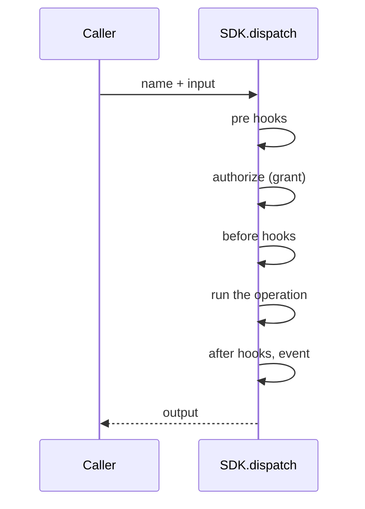

# SDK

Plugins and apps follow [How to build well](agents.md#how-to-build-well).

The SDK is everything a plugin, an admin page or an integration needs to
extend Publr. It has three parts:

- **Operations**: the API surface. Every capability of Publr is one.
- **Hooks**: how to plug into what already exists.
- **UI**: the components and pages the admin is made of.

Nothing outside the SDK is available to a plugin. Nothing inside it is
reserved for the core.

## Operations

An operation has a **name** (`namespace.verb`, e.g. `heartbeat.check`), a
one-line **description**, an **input**, an **output**, and a **kind**: it
either reads or it writes. A plugin's operation says who may call it: by default
administrators and roles granted it, or a ready answer (anyone signed in, a role, any
visitor) or a check of its own. One that callers without credentials may reach says so
(`untrusted_callers`); a site's pages call it at `app.<plugin>.<verb>`, where an
administrator is a signed-in person like any other (see [Auth](auth.md#roles)).

Inputs and outputs are plain data: text, numbers, booleans, lists, small
records. No pointers, no callbacks, nothing that cannot be written down as
JSON. This is what lets the same operation be called from Zig, from the
command line, over HTTP and from a plugin sandbox without translation.

Every operation also carries one **example input**. The example is used to
prove, automatically, that the operation behaves identically whichever way it
is called.

A call's memory is its request's, fixed in size and given back only when the
request ends. A loop over many items (units of a merge, documents of a write)
keeps each item's working data in the request's **scratch** and gives it back
before the next item, so the loop needs one item's memory, however many there
are, and only its results stay.

### Dispatching an operation



1. The caller hands a name and input to `SDK.dispatch`.
2. The SDK runs the pre hooks, authorizes the call (producing a grant), and
   runs the before hooks.
3. The SDK runs the operation with its grant, calling the internals
   directly, inside a transaction if it writes.
4. The SDK runs the after hooks, emits the event, and returns the output to
   the caller.

### Running an operation

`dispatch` runs the operation now and returns its output. An operation that
dispatches another operation runs it immediately, inside its own transaction,
and remembers that it caused it. There is no deferred or background form: if
something should happen later (a scheduled publish, a notification), a plugin
keeps that intent as a record and runs the operation when the time comes.

### Calls to parent plugin operations

A child names `"parent@^0.4"` in its `depends_on` (or `compatible_with` for a parent it
only uses when present) and describes each parent operation it uses as a remote, in its
own words: what it sends and what it reads. It never imports the parent. `ctx.call(Remote,
input)` uses the core gateway by operation name in both
native and installed execution. Records and events of the parent are described the same
way (`publr.remote.record`, `publr.remote.event`), with only the fields the child reads.
Each is checked against the parent: when both are compiled in, at enable, and whenever the
parent changes. A required parent that no longer fits keeps the child off (compiled in
together, the build fails); an optional one switches only that remote off (compiled in
together, the build notes it), and a call to it answers `Unavailable`.
An installed child also requests an exact permission such as
`.{ .key = "call:app.parent.adjust", .reason = "<why this child needs it>" }`, or
`call:parent.adjust` for one of its operations that is not an app's.
These grants are medium tier: granted when the child is installed and listed on its
page. A grant reaches only a plugin named in `depends_on` or `compatible_with`, and a dependency
alone grants nothing. The caller's roles still apply. The compiler checks the declaration, and every
call is authorized when it runs.

A write and the before and after hooks on it share one transaction, so a failing hook
rolls back the operation it hooks. A write made inside another is a savepoint: if it fails,
only its own changes are undone, and the caller decides what happens next. An error nobody
catches rolls back the whole write.

### The grant

Authorization returns a grant, not a boolean. A grant can say:

- allowed or denied;
- read-only;
- only these content types, only these statuses;
- only the content types of these plugins, beside the project's own (an app's `.plugins`);
- only the content types living in this app or shared with it (a call made for an app);
- only records the caller owns, or only records a plugin-supplied check accepts;
- hide or refuse these fields;
- only these status transitions.

The operation is responsible for honouring its grant: filtering what it lists,
refusing what it may not write. Tests exercise every operation under a
restrictive grant to make sure it does.

### Callers

The pipeline always knows who is calling: an anonymous visitor, a user (with the
roles it holds), a device acting for a user (its roles, narrowed by the scope its person
approved: [Authentication: Devices](auth.md#devices)), a machine token with its own policy,
the local operator (`system`), or a plugin with a set of permission scopes.
Policies use this to decide the grant. The CLI runs as anonymous unless told
otherwise (`--as <user id or email>`, `--as-admin`).

A policy also knows where a call comes from. A call an adapter makes (the CLI,
REST, the admin) comes from outside; a call an operation makes while it runs
comes from inside that operation, and the policy sees its name. So a plugin can
let its own operations write records on the caller's behalf while refusing the
same caller writing them directly. A grant limited to the caller's own records
is asked of the database as such, so a list's limit and offset count only those.

An operation that destroys what cannot be had back declares `destroys = true` (deleting a
content type, purging a record): a device is refused it whatever it may otherwise do,
and a person does it in the admin. A write by a device allowed only drafts is refused
whole when it publishes or unpublishes anything (a `*.published` or `*.unpublished`
event).

An operation may declare `open` (anyone may call it, like signing in) and
`allow_frontmatter_calls` (a dynamic page may run it when it is opened,
`Publr.request.call()`; see [Apps](apps.md)). The second is a promise that being
triggered by a visit, with no form and no CSRF token, is harmless: marking something
seen, counting a view.

Users and sessions are ordinary operations: `project.init` (first admin,
exactly once), `user.create` (with a password, a generated one, or a
set-password link), `users.password_link`, `users.set_password`,
`user.list`, `user.sign_in` (sign in: email + password to token) and
`users.sign_out` (sign out). The HTTP adapter wraps sign-in, sign-out and
set-password as `POST /api/auth/sign-in|logout|set-password` with a cookie, and
`GET /api/auth/session` says who the cookie belongs to.

### Self-describing operations

Operations are grouped in namespaces (`users`, `heartbeat`, `record`, a plugin's own),
and a namespace has a summary and an explanation of what lives in it; the SDK refuses an
operation whose namespace is undocumented. A plugin's namespace is its own words, the
`//!` comment of its `main.zig`. An operation carries its own documentation next to its
code (a plugin's in the doc comment above it, read from the source when it builds): a one-line
description, a longer explanation (who may call it, what it changes, how it
fails), a note per input and output field, an example input, an example
output, and the caller the example runs as. Every adapter renders the same
text: `publr <namespace> <verb> --help` prints all of it with a runnable
example and its JSON, and the REST adapter will serve it. Documentation that
lives in the operation cannot drift from the operation.

### What is logged

Every top-level call is logged by the core, once: a completed write in the activity log,
inside its transaction, and a refused or failed call, reads included, in the error log,
after its rollback. The calls it sets off inside are part of its entry, not entries of
their own. An operation lists the input fields that hold a secret (`secret`), and any
field named like one is masked too, so a password never reaches a log. Both logs are
append-only (`docs/schema.md`, `activity` and `errors`).

### The shape

Just enough to see it; the full contract lives in the code and tests. A plugin writes
its operations with `publr.operation.define` and its words as doc comments (see
[Plugins](plugins.md#operations)); core declares its own like this:

```zig
pub const Check = struct {
    pub const name = "heartbeat.check";
    pub const description = "Check that Publr is alive; reports version and caller";
    pub const kind = .read;
    pub const In = struct { echo: []const u8 = "" };
    pub const Out = struct { version: []const u8, echo: []const u8, caller: []const u8 };
    pub const example: In = .{ .echo = "hello" };
    pub const example_out: Out = .{ .version = "0.2.0", .echo = "hello", .caller = "system" };
    // run(ctx, in, grant): the work
};
```

That is the whole contract: a name, a sentence, read or write, the input and
output structs, one example call with the answer it gives, and `run`. Optional:
`details`, `field_docs`, `output_docs` for richer help. What a call touches, for
policies, is read from the input by field name (`type`, `id`, `to`).

An operation fails with the core's errors (`error.Denied`, `error.NotFound`,
`error.Conflict`, ...) or with a failure of its own, for what the core has no word for. A
plugin lists its failures in the operation's `Fails:` words and refuses with
`ctx.fail(.Unverified, "Verify your email to create more sites", .{})`. Core declares
them as values:

```zig
pub const unverified: sdk.operation.Failure = .{
    .name = "Unverified",
    .status = 403,
    .message = "Verify your email to create more sites",
};

pub const failures = [_]sdk.operation.Failure{unverified};   // in the operation: for --help

return ctx.fail(unverified);                                   // in run
```

`ctx.fail` rolls the write back like any error; REST answers
`{ "error": "Unverified", "message": "…" }` with the status, the CLI prints the message,
and `--help` lists the operation's `failures`.

The example is not decoration. `--help` prints it, and `zig build parity` runs
it: every operation's printed command line is executed against a database built
for it, and the answer is checked against the printed `example_out`. An example
that stops being true fails the build.

## Hooks

Hooks are how a plugin plugs into behaviour that already exists. There are
six kinds:

| Hook | When | Can |
|---|---|---|
| **pre** | before authorization, for every call | veto (rate limits, abuse protection) |
| **before** | after authorization, on a named operation | see and change the input, or veto |
| **after** | on a named operation or event, inside the write | observe input and output, or veto (rolls back) |
| **on** | on a named operation or event, from the queue once the write committed | react to its answer or payload; the only one that may call out |
| **policy** | during authorization | narrow the grant |
| **filter** | when the admin shows a value of a named type | change how it reads, as text |

A filter changes how a value is shown, never what is stored or what an operation answers.
The first point is a record's title: the admin's lists, its reference picker and its
reference cards run the filters once per page, per type. A filter is written for one item
(the record, typed, and what is shown for it) and Publr runs it over the batch in passes,
reading what the items ask for together between them (products names a variant
`Earl Grey, 50 g`, reading every variant's product in one list). It reads through the SDK,
as granted, and may not write or call out. What it answers is text: cut to 512 bytes,
control characters made spaces, escaped where it is shown. A filter that fails leaves the
item as it was.
No hook can put markup or a script on a page; printed markup is always sanitized
(`set:html`), and a script reaches a page only as an island or an approved plugin script.

Every operation emits an **event** under its own name when it succeeds, carrying its
answer; a failure emits nothing. A plugin declares an event of its own with a typed payload
(`publr.event.define`) and emits it with `ctx.emit(Event, payload)`; the payload travels as
JSON. Events are queued in the write's transaction, so a rolled-back write drops them, and
`on` hooks hear them once it commits. Core's typed events are `role.created|updated|removed`
(`.role`), `auth.user_created` (`.user`), `internal.created|saved|deleted` (`.record`) and
the sign-in ones (`publr.auth.SignedIn`, `SignedUp`, `SignedOut`), all declared in one shape
(`publr.event.define(.{ .name, .payload })`). What is not a successful call is kept outside
the write that raised it, so a refusal's rollback does not drop it, and heard by `on` hooks
only: the sign-ins refused (`auth.sign_in_throttled`, `auth.sign_in_failed`,
`auth.sign_in_locked`, `auth.sign_on_replayed`, `auth.sign_on_failed`,
`auth.identity_refused`) and `errors.failed` (`publr.errors.Failed`), raised for each
Error log entry that is an error rather than a refusal the caller was told, for error
trackers and alerts. Every move of a record or a term raises its type's transition event
(`post.transitioned`, a plugin's type `shop.product_transitioned`, what
`Posts.any_transition` hooks) with `.{ .record, .transition, .from, .to }`, and a plugin's
type also the transition's own (`shop.product_archive`); a move over many raises it for
each record. What else a record write did is in its own event: `record.save` answers
`outcome` (`saved` into the record's own document, `changes_saved` parked on a live one,
`changes_discarded`, `unchanged`), `record.publish` the status it reached.

Anything else that changed is the operation that changed it, never a second name: a
plugin enabled is `plugin.enable` finishing, a type changed is `content_type.update`.
Core's own readers (the activity log, a plugin recording deployments) hook those
operations `after`, as any plugin would, and read what changed from their input and
answer (`sdk.changed_units`: a record's or term's id, a type's or taxonomy's handle, a field
group's, a plugin's name, a view, an account, each unit `project.put` put), and a move over
many from each record's transition event. The site-changes index hears records the same way. `apps.loaded` (an app's name, each time
`serve` loads the apps from the folder, at start and on `publr apps load`) is emitted by
the server itself, as the system, outside any operation (`SDK.announce`).

Beyond hooks, a plugin registers its own **operations**, **records** (content types and
internal records, with their statuses and moves; created when the database opens, kept in
the same tables as everything else) and **field kinds** (a storage class and its own value
check), all in one registration. Drafts, revisions, workflows,
activity logs, notifications and live updates are all built from these
pieces.

## UI

The admin is built from a shared component kit and pages authored in a
portable JSX dialect. A plugin ships its pages and slot contributions in that
same dialect and imports the same components; the compiler turns them into
server-rendered and client-side code. Pages load their data by calling
operations, so plugin UI gets permissions and logging for free.

## Testing

Every operation's documentation is executable. `zig build parity` gives each one
a fresh database, seeds what its example names, reads the example command line
back off the binary's own `--help`, runs exactly that, and checks the answer
against the printed `example_out`. So an operation cannot ship documentation
that does not work, and the CLI adapter cannot drift from the operation without
the build noticing. Operations also test their own behaviour, including under
restrictive grants.
